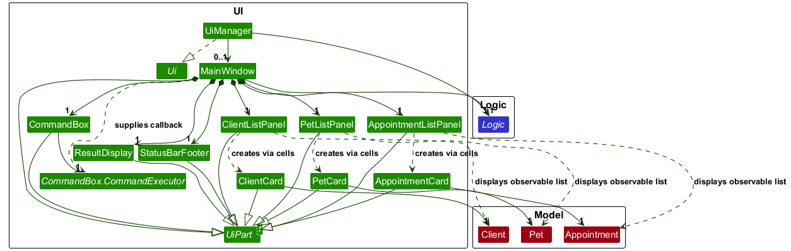

* Table of Contents
{:toc}

--------------------------------------------------------------------------------------------------------------------

## **Acknowledgements**

* _{List the sources of reused or adapted ideas, code, documentation, and third-party libraries here, with links to the originals.}_

--------------------------------------------------------------------------------------------------------------------

## **Setting up, getting started**

Refer to the guide [_Setting up and getting started_](SettingUp.md).

--------------------------------------------------------------------------------------------------------------------

## **Design**

:bulb: **Tip:** The `.puml` files used to create diagrams are in `docs/diagrams`. Refer to the [_PlantUML Tutorial_ at se-edu/guides](https://se-education.org/guides/tutorials/plantUml.html) to learn how to create and edit diagrams.

### Current code organization

`ModelManager` owns one `BubuBook`, which contains clients, pets, and the appointment schedule.
Consumers read it through `ReadOnlyBubuBook` and `Model.getBubuBook()`.
`Client` replaces the inherited `Person` type. `UniqueClientList`, `UniquePetList`, and
`AppointmentList` enforce the rules for each collection inside the shared book.

| Responsibility | Package under `seedu.address` |
| --- | --- |
| Shared model and preferences | `model` |
| Client, pet, and appointment records | `model.client`, `model.pet`, `model.appointment` |
| Feature commands | `logic.commands.client`, `logic.commands.pet`, `logic.commands.appointment` |
| Feature parsers and CLI prefixes | `logic.parser.client`, `logic.parser.pet`, `logic.parser.appointment` |
| Shared tokenization and command routing | `logic.parser` (`BuBuParser`) |
| JSON record adapters | `storage.client`, `storage.pet`, `storage.appointment` |
| Client, pet, and appointment cards and list panels | `ui.client`, `ui.pet`, `ui.appointment` |

Tests mirror these feature packages. Shared parsing utilities stay in `logic.parser.ParserUtil`;
client and pet field parsing lives in `ClientParserUtil` and `PetParserUtil` respectively.
`AddAppointmentCommand` and `AddAppointmentCommandParser` handle the `add-appointment` command.
`ListPetsCommand` and `ListAppointmentsCommand` prepare the corresponding filtered views.
`DeletePetCommand` and `DeleteAppointmentCommand` accept either a one-based displayed index or an identifier form;
appointment deletion also accepts a date/time pair.
`EditAppointmentCommand` and `EditAppointmentCommandParser` accept either a date/start-time identifier or a displayed
appointment index, with `nd/` and `nst/` prefixes reserved for replacement date and start time values.
`EditPetCommand` and `EditPetCommandParser` implement identifier-based pet updates without changing the existing
phone-identified client-edit flow.

Replacing the BubuBook validates all collections before changing existing records and keeps
observable list views connected to the model. Client edits update linked pet owners.
The `clear` command removes all clients, pets, and appointments, including historical bookings.

All clients, pets, and appointments are saved together in `data/bububook.json` through
`JsonBubuBookStorage`. The JSON contains `clients`, `pets`, and `appointments` lists.
`preferences.json` remains separate for window settings. The former `addressbook.json` and
`appointments.json` files are no longer read or written; there is no automatic migration.

When upgrading from a version using `data/groombook.json`, close the app and copy that file to
`data/bububook.json` before starting the new version. Keep the original file as a backup.

`help`, `exit`, `list-clients`, `list-pets` and `list-appointments` do not save records. Other commands save the shared
book only when its persisted contents change. Saving writes a temporary file before replacing
the previous file. If saving fails, the previous in-memory book is restored. Unreadable data blocks
commands so the saved file cannot be overwritten with an empty book.

### Architecture

The ***Architecture Diagram*** given above explains the high-level design of the App.

Between components, an arrow points from a component to another component that it depends on.

The following provides a quick overview of the main components and their interactions.

**Main components of the architecture**

**`Main`** (consisting of classes [`Main`](https://github.com/AY2627S1-CS2103T-W08-2/tp/blob/master/src/main/java/seedu/address/Main.java) and [`MainApp`](https://github.com/AY2627S1-CS2103T-W08-2/tp/blob/master/src/main/java/seedu/address/MainApp.java)) is in charge of the app launch and shut down.

* At app launch, it initializes the other components in the correct sequence, and connects them up with each other.
* At shut down, it shuts down the other components and invokes cleanup methods where necessary.

The bulk of the app's work is done by the following four components:

* [**`UI`**](#ui-component): The UI of the App.
* [**`Logic`**](#logic-component): The command executor.
* [**`Model`**](#model-component): Holds the data of the App in memory.
* [**`Storage`**](#storage-component): Reads data from, and writes data to, the hard disk.

[**`Commons`**](#common-classes) represents a collection of classes used by multiple other components.

**How the architecture components interact with each other**

The *Sequence Diagram* below shows how the components interact with each other for the scenario where the user issues
the command `delete-client 1`. It focuses on how a command is executed, saved, and rolled back if saving fails. The
client panel is assumed to be selected and index 1 is assumed to be valid. Lower-level parsing and deletion details
are omitted from the diagram.

How the command is executed and saved:

1. `Logic` parses and validates the command.
2. `Logic` retrieves the current data from `Model` and creates a backup copy.
3. `Logic` applies the validated command to `Model`.
4. `Logic` asks `Storage` to save the updated data.
5. If saving succeeds, the UI displays the command's success message.
6. If saving fails, `Logic` restores the backup copy in `Model` and the UI displays a storage error.

The rollback restores client, pet, and appointment records in memory, but does not restore UI selection or filters.
Parse and command validation failures occur before saving. `help`, `exit`, `list-clients`, `list-pets` and
`list-appointments` do not trigger a record save. Other commands also skip saving if the book is unchanged.

Each of the four main components (also shown in the diagram above),

* defines its *API* in an `interface` with the same name as the Component.
* provides its functionality through a concrete `{Component Name}Manager` class that implements the corresponding API interface.

For example, the `Logic` component defines its API in `Logic.java` and implements it in `LogicManager.java`. Other components interact with a component through its interface rather than its concrete class, preventing them from coupling to that component's implementation, as illustrated in the following partial class diagram.

The sections below give more details of each component.

### UI component

The **API** of this component is specified in [`Ui.java`](../src/main/java/seedu/address/ui/Ui.java)

`UiManager` implements `Ui` and creates the `MainWindow` when the application starts. Both hold a reference to the `Logic` API. The diagram omits JavaFX controls and internal list-cell classes for clarity.

The UI consists of a `MainWindow` and its parts, such as `CommandBox`, `ResultDisplay`, `ClientListPanel`,
`PetListPanel`, `AppointmentListPanel`, and `StatusBarFooter`. All of these, including `MainWindow`, inherit from
the abstract `UiPart<T>` class (as do `ClientCard`, `PetCard`, and `AppointmentCard`), which captures common behavior among classes that represent visible GUI parts.

The `UI` component uses the JavaFX UI framework. The layouts of these UI parts are defined in matching `.fxml` files in `src/main/resources/view`. For example, [`MainWindow.fxml`](../src/main/resources/view/MainWindow.fxml) specifies the layout of [`MainWindow`](../src/main/java/seedu/address/ui/MainWindow.java).

The `UI` component,

* executes user commands using the `Logic` component.
* displays observable lists obtained through `Logic`, so changes to model data update the lists automatically.
* keeps a reference to the `Logic` component, because the `UI` relies on the `Logic` to execute commands.
* depends on `Client`, `Pet`, and `Appointment` classes from the `Model` component because its three list panels
  display those records.

`CommandBox` invokes a `CommandExecutor` callback supplied by `MainWindow`. This callback calls `Logic.execute`, updates `ResultDisplay` with success or error feedback, and handles display changes, help, and exit requests. `MainWindow` also restores and saves window settings through `Logic`; `StatusBarFooter` displays the data file path supplied at startup.

Each list panel uses custom JavaFX cells to create its corresponding card. Pet cards show an owner heading at the start of each owner group, and appointment cards show a date heading at the start of each date group. Their panels refresh these headings when the lists change. Sorting is provided by the model.

`MainWindow` creates all three list panels once and keeps them bound to the model's observable lists. It shows exactly
one panel at a time, initially clients, using the `DisplayType` carried by `CommandResult`: `CLIENTS`, `PETS`, or `APPOINTMENTS`.
Successful list commands set this value, and commands that do not change the selected record type use
`UNCHANGED`. Hidden panels are also unmanaged so that they do not occupy layout space. The record heading and count track the visible list.

The `help` command returns the command reference stored in
`src/main/resources/help/CommandReference.md`. `MainWindow` displays this result in
`ResultDisplay`, which renders command names and command formats with distinct styles in a scrollable inline view.
The **Help** menu item and <kbd>F1</kbd> invoke the same command. When adding or changing a command, keep this
reference in sync with the User Guide.

`CommandBox` maintains session-only command history independently of the `Logic` and `Model` components. It records
each non-empty submission before invoking its `CommandExecutor`, so commands that fail parsing or execution can also
be recalled and corrected. Edited or unfinished text is saved separately in `commandDraft` before navigating history, rather than appended to the submitted-command history. The `commandHistory` list keeps submissions in order, while `historyIndex` points to the currently recalled entry. An index equal to the list size represents the position after the newest submission.

The command text field handles <kbd>↑</kbd> and <kbd>↓</kbd> key presses through a JavaFX event filter. <kbd>↑</kbd>
moves the index towards the oldest entry and <kbd>↓</kbd> moves it towards the blank position. Navigation stops at
both boundaries rather than wrapping. When no commands have been recorded, the event filter does not consume either
arrow key, allowing normal focus or page navigation to proceed. When an entry is loaded, the caret is placed at the
end so that users can edit it immediately. This state is intentionally not persisted: restarting the application
starts a new history and avoids storing commands that may contain client information.

### Logic component

**API** : [`Logic.java`](https://github.com/AY2627S1-CS2103T-W08-2/tp/blob/master/src/main/java/seedu/address/logic/Logic.java)

Here's a (partial) class diagram of the `Logic` component:

`LogicManager` implements `Logic` and holds one `BuBuParser`, `Model`, and `Storage` reference.
The diagram shows `EditClientCommand`, `EditPetCommand`, and `EditAppointmentCommand` as examples of concrete
`Command` subclasses; other commands are omitted. `Command.execute(Model)` returns a `CommandResult`, whose
`DisplayType` identifies the list to show or requests that the current selection remain unchanged.

The sequence diagram below illustrates the interactions within the `Logic` component, taking `execute("delete-client 1")` API call as an example.

The appointment command flows are shown separately because both commands support two target forms:

How the `Logic` component works:

1. `LogicManager` passes the input to `BuBuParser.parseCommand`. For feature commands, `BuBuParser` creates the
   matching parser (e.g., `DeleteClientCommandParser`) and calls `parse(arguments)`. It creates `ClearCommand`,
   `HelpCommand`, and `ExitCommand` directly.
2. Before executing the returned `Command`, `LogicManager` rejects commands other than `HelpCommand` if the saved
   book was unreadable at startup and checks any display requirement declared by `Command.getRequiredDisplayType()`.
3. `LogicManager` takes a book snapshot, then the command executes against `Model` and returns a `CommandResult`.
   `HelpCommand`, `ExitCommand`, `ListClientsCommand`, `ListPetsCommand` and `ListAppointmentsCommand` skip record
   saving. Other commands save only if the resulting book differs from the snapshot. If saving fails, the snapshot
   is restored and a `CommandException` is thrown instead of returning success.
4. After successful execution and any required save, `LogicManager` updates its current display type from the
   result and returns it to the UI. `UNCHANGED` preserves the previously selected list.

The following partial diagram expands the parser structure using one edit-command parser from each feature.
Helper dependencies are expanded only for `EditAppointmentCommandParser` to keep the diagram readable;
the other parsers also use shared helpers as required.

How the parsing works:
* `BuBuParser` separates the command word from its arguments and selects the corresponding feature parser.
  Each feature parser implements `Parser<T>` for its command type: for example, `EditPetCommandParser`
  implements `Parser<EditPetCommand>`. Its `parse` method validates the arguments and constructs the command,
  which `BuBuParser` returns as a `Command`.
* Prefix constants belong to `ClientCliSyntax`, `PetCliSyntax`, or `AppointmentCliSyntax` in the corresponding
  feature package. `ArgumentTokenizer` uses the supplied `Prefix` objects to produce an `ArgumentMultimap`,
  which stores argument values by prefix.
* `ParserUtil` parses positive indices; it does not define or depend on prefixes. `ClientParserUtil` parses
  client fields, including owner phone numbers used by pet and appointment commands. `PetParserUtil` parses
  pet names. For example, `EditAppointmentCommandParser` uses all three utilities because it supports an index,
  an owner phone number, and a pet name.

Index-based commands accept exactly one positive integer index:

* `delete-client INDEX` uses the currently displayed client list.
* `edit-client INDEX ...` uses the currently displayed client list, including its active filter and sort order.
* `delete-pet INDEX` uses the currently displayed pet list.
* `delete-appointment INDEX` uses the currently displayed appointment list, whether it is the ongoing/future view or a
  date-filtered view.
* `edit-appointment INDEX ...` uses the currently displayed appointment list.
* Identifier forms such as `delete-client i/PHONE_NUMBER`, `edit-client i/CURRENT_PHONE [p/NEW_PHONE] ...`,
  `delete-pet p/PET_NAME i/OWNER_IDENTIFIER`, and
  `edit-pet p/PET_NAME i/OWNER_IDENTIFIER [n/NEW_PET_NAME] [s/SPECIES] [b/BREED] [r/REQUIREMENTS]`
  search the saved BubuBook instead of relying on the displayed list.

`LogicManager` tracks the current `DisplayType` and rejects an index-based deletion or edit when the
corresponding record list is not displayed. This prevents an index from being interpreted against a different record type.

#### Client editing by displayed index or phone number

The following sequence diagram shows editing a client using their current phone number:

`BuBuParser` routes `edit-client` to `EditClientCommandParser`. The parser accepts either a positive, one-based
`INDEX` or `i/CURRENT_PHONE`, and requires at least one update field. Supplying both selectors is rejected.
For example, `edit-client 1 n/Zoe Tan` edits the first displayed client, while
`edit-client i/91234567 n/Zoe Tan` selects a client by their current phone number.
`p/` supplies a replacement phone number. Names, emails, addresses, and tags use `n/`, `e/`, `a/`, and `t/`.

For index selection, `LogicManager` requires the client panel to be displayed. `EditClientCommand` selects from
`Model.getFilteredClientList()` in its displayed order, including any active search filter and alphabetical sorting.
An out-of-range index is rejected without changing records. For phone selection, the command searches all saved
clients independently of the displayed panel or search filter, so hidden clients can still be edited.
It rejects unknown identifiers and phone/email conflicts with other saved clients before mutation.
`BubuBook#setClient` replaces the client, refreshes pet owner profiles, and calls `AppointmentList.updateOwner`.
Linked ongoing and future appointment owner snapshots receive the edited client details. Completed snapshots retain
their recorded name, email, address and tags so later client profile edits preserve the context of the completed
appointment. Completion means the appointment's end date and time are at or before the edit time in Singapore time.
Ownership is determined by phone number, independently of snapshot email, name or address. Phone changes propagate
to linked pets and all linked appointments, including completed ones, to preserve that relationship. Appointment
dates, times, services and other pet details are preserved during client edits.
New or changed phone numbers are also checked against historical appointment owner snapshots. A phone number cannot be
reused when it would make a registered client ambiguous with a different historical owner.
After a phone change, subsequent commands must use the new phone in `i/`; the old phone no longer identifies that client.

Successful edits preserve the active client filter and return `DisplayType.CLIENTS`. `LogicManager` saves the updated
records and restores the previous records if saving fails. An edited client can disappear from the displayed list
if the updated details no longer match its active filter. Only the phone-selector form bypasses the client-panel guard.

#### Identifier-based pet editing

`edit-pet` is deliberately identifier-based rather than index-based. A displayed index is transient: it depends on the
currently selected panel and any active pet filter. A pet's current name together with its owner's phone number is a
stable, domain-level identifier because pet names only need to be unique within an owner.

The execution flow is:

1. `BuBuParser` routes `edit-pet` to `EditPetCommandParser`.
2. The parser tokenizes the target prefixes (`p/` and `i/`) and the optional update prefixes (`n/`, `s/`, `b/`, and
   `r/`). It rejects a preamble, unknown prefix, duplicate prefix, missing target selector, invalid value, or a command
   with no updates. It constructs an `EditPetDescriptor` containing only the requested changes.
3. `EditPetCommand` searches `Model.getBubuBook().getPetList()` for the normalized current pet name and exact
   owner-phone pair. Both target lookup and the later duplicate check use `PetName.getNormalizedName()`, which ignores
   letter case and leading, trailing, or repeated whitespace.
   It intentionally does not use `getFilteredPetList()`, so the command works regardless of the currently displayed
   record panel or a pet filter.
4. The command creates a new immutable `Pet`, retaining the existing owner and every field omitted from the descriptor.
   Before replacement, it checks that the new name does not collide with another pet belonging to that owner.
5. `Model.setPet` delegates to `BubuBook.setPet`, which replaces the record through `UniquePetList` and calls
   `AppointmentList.updatePet`. Linked appointments ending strictly after the edit time in Singapore time receive
   the edited pet details. Completed appointments, including those ending exactly at the edit time, retain their
   recorded pet details except for a changed pet name. The recorded owner, appointment date, times and service are
   preserved. The command preserves the active pet filter and returns a success `CommandResult`.
6. `LogicManager` saves the updated `BubuBook`. It keeps a pre-command snapshot and restores it if saving fails, so a
   failed write does not leave an in-memory edit that was not persisted.

The descriptor uses an explicit `isBreedEdited` flag. This distinguishes an omitted `b/` prefix (keep the existing
breed) from an empty `b/` value (set the optional breed to `null`, thereby clearing it). The owner has no descriptor
field, which makes transferring a pet impossible through this command by design.

### Model component

**API** : [`Model.java`](https://github.com/se-edu/addressbook-level3/tree/master/src/main/java/seedu/address/model/Model.java)

The `Model` component,

* defines its API in `Model`. `ModelManager` implements that API and owns a copy of the supplied `BubuBook` and
  `UserPrefs`; callers access the book through `ReadOnlyBubuBook` and preferences through `ReadOnlyUserPrefs`.
  `BubuBook` is the aggregate that stores clients, pets, and appointments in `UniqueClientList`, `UniquePetList`, and
  `AppointmentList` respectively.
* represents clients as immutable `Client` records with a name, phone, email, address, and tags. A client is considered
  a duplicate when another client has the same phone number or email address.
* represents pets as immutable `Pet` records with a name, owner, species, optional breed, and grooming requirements.
  Each pet refers to its owning `Client`; when the book adds or replaces a pet, it resolves that owner to the matching
  client stored in the book. Pet identity is the owner's phone number and normalized pet name, so names are unique per
  owner and letter case or leading, trailing, and repeated whitespace do not affect matching.
* represents appointments as immutable records containing owner and pet snapshots, date, start and end times, and
  service. An appointment must use a pet belonging to its owner and last at least 30 minutes. `AppointmentList`
  rejects overlapping time slots regardless of owner or pet, while permitting adjacent appointments. Past appointments
  can remain in the schedule as historical records; scheduling commands enforce that new appointments start in the
  future.
* keeps linked records consistent when they are edited or removed. Replacing a client updates its pets' owner
  references and the owner snapshots in linked ongoing and future appointments. Pet edits refresh the pet snapshots
  in linked ongoing and future appointments. Appointments ending at or before the edit time in Singapore time retain
  historical details, except for linked owner-phone and pet-name changes. Profile edits preserve appointment dates,
  times and services. Removing a client also removes that client's pets and appointments; removing a pet removes its
  appointments. Clearing the book removes all three record types.
* validates replacement data before applying it to the live book. This applies when loading or replacing the book and
  when replacing its client, pet, or appointment lists. The observable list instances remain connected to the model so
  existing UI views continue to receive changes.
* maintains observable display views for clients, pets, and appointments by filtering and sorting the book's lists.
  Pets are ordered by owner name (case-insensitive), owner phone, and normalized pet name; appointments are ordered by
  date and start time. Clients can be sorted by name on request. Display ordering does not reorder the saved lists in
  `BubuBook`.
* stores GUI preferences in `UserPrefs`, which is exposed through the read-only preferences interface.
* has no dependency on the `Logic`, `UI`, or `Storage` components. Those components use the model API to interact with
  the domain data.

:information_source: **Note:** The model diagram below shows the API and coordination classes, the collections owned by `BubuBook`, and the relationships between client, pet, and appointment records. 

### Storage component

**API** : [`Storage.java`](https://github.com/AY2627S1-CS2103T-W08-2/tp/blob/master/src/main/java/seedu/address/storage/Storage.java)

The `Storage` component:

* saves the complete BubuBook in `data/bububook.json`, with user preferences in `preferences.json`.
* is implemented by `StorageManager`, which delegates to `JsonBubuBookStorage` and `JsonUserPrefsStorage`.
* represents the complete saved data with `JsonSerializableBubuBook`, which contains lists of
  `JsonAdaptedClient`, `JsonAdaptedPet`, and `JsonAdaptedAppointment` records. Each client record can contain
  multiple `JsonAdaptedTag` records.
* represents pets with `JsonAdaptedPet`, which stores each owner's name and phone. It uses these identifiers to
  resolve the registered client when the data is loaded. The `breed` property contains a string when known and
  JSON `null` when no breed is set; older records with no `breed` property are also accepted when loading.
* represents appointments with `JsonAdaptedAppointment`, which stores client and pet snapshots so appointments
  can be reconstructed independently of the current registered records. Legacy appointment records identify their
  participants using `ownerPhone` and `petName` instead of snapshots.

Therefore, an appointment contains participant snapshots, while a pet refers to its owner using identifiers. This
is why the appointment adapter is associated with the participant adapters in the class diagram, while the pet
adapter is not associated with the client adapter.

#### Loading data

Storage reconstructs the saved data in the following order:

1. Clients and their tags are loaded.
2. Pets are loaded and their owners are resolved against the loaded clients.
3. Appointments and their participant snapshots are loaded.

Loading fails if required lists or fields are missing, records are invalid, clients or pets are duplicated, or
appointments overlap. If the data file is missing, BuBu starts with sample data. If it is unreadable, BuBu starts
with an empty in-memory book and blocks commands other than `help` to prevent that empty book from overwriting the file. User
preferences are loaded separately.

#### Saving and rollback

`JsonBubuBookStorage` remembers the exact bytes from each successful read or save, keyed by canonical file path.
A missing file is recorded separately from an existing file; saving over an existing file without reading it is
rejected. Before replacing records, storage acquires an operating-system lock on `bububook.json.lock` and checks
that the current bytes still match. The check and replacement share the same lock, preventing two BuBu processes
from both accepting a stale version. Saves in the same JVM are serialized before opening lock channels.
The sidecar file remains on disk so all writers keep using the same lock; the lock itself is released after saving.

A changed or deleted file raises `RecordSaveConflictException` and tells the user to reopen BuBu. A busy lock asks
the user to retry. `LogicManager` preserves these messages for every command and restores the pre-command records.
Only a successful replacement updates the remembered version. Manual file edits must still be made with BuBu closed,
because external editors do not participate in this locking protocol.

When saving data:
`help`, `exit`, `list-clients`, `list-pets` and `list-appointments` never trigger a record save. Other commands skip
saving when the resulting book equals the pre-command snapshot. When records have changed:

* `JsonBubuBookStorage` serializes the complete book and writes it to a temporary file.
* It replaces `data/bububook.json` only after the temporary file has been written successfully.
* `LogicManager` copies the current book before executing a command.
* If saving throws an `IOException`, `LogicManager` restores that copy and reports a storage error.

The rollback restores the in-memory records. It does not restore a previous version of the data file.

The record path is relative to the working directory used to launch BuBu. `MainApp.stop()` attempts to save window
preferences separately in `preferences.json` during shutdown; it does not save the book. Preference saves do not
use the shared-book rollback path.

#### Pet-profile persistence

Pet edits are persisted through the same shared-book path as other record-changing commands:
`EditPetCommand` → `ModelManager.setPet()` → `BubuBook.setPet()` → `UniquePetList.setPet()` →
`StorageManager` → `data/bububook.json`.

`Pet` is immutable, so an edit replaces one complete profile rather than mutating individual fields. The optional
breed is serialized as a nullable property: adding a pet without `b/BREED` writes `"breed": null`, and clearing an
existing breed with `b/` writes the same value on the next successful save. The property is retained, not omitted.
Loading accepts either an absent `breed` property or `"breed": null` as an unknown breed. This representation also
applies to pet snapshots stored within appointments; completed snapshots retain their historical breed under the
participant-update rules below.

#### Appointment persistence

Appointments belong to the shared `BubuBook` and are saved in the same file as clients and pets.
`Appointment` holds immutable `Client` and `Pet` objects. `AddAppointmentCommandParser` parses participant
identifiers; `AddAppointmentCommand` resolves them against the full registered lists when executed.
Client and pet edits refresh the respective participant snapshots in linked ongoing and future appointments.
Completed appointments preserve historical details except for linked owner-phone and pet-name changes. Deleting a
client or pet removes its related appointments from the active `BubuBook` before the change is saved.
`JsonAdaptedAppointment` stores nested owner and pet snapshots alongside the date, times, and service.
Loading reuses equal registered objects when available and can reconstruct historical snapshots independently of the
registered lists. This storage capability does not provide a supported JSON import or data-merging workflow.
Owner identity is the phone number throughout clients, pets, and appointments. `Appointment.isForOwner` compares
phones; `isForPet` compares the owner phone and normalized pet name. Historical names, emails, and addresses may differ
from current profile values after edits and do not change identity. Client phone edits propagate the new phone to
linked pets and appointments, including completed appointments.

BuBu supports records maintained through its commands and unchanged backups of its own saved files. Importing external
JSON, merging books, and manually modifying records are unsupported. In particular, assigning the same phone to different
people in manually constructed client and appointment records violates the ownership invariant. Such records may pass
structural validation; BuBu treats a shared phone as one owner and does not infer separate identities from snapshot
emails or names. The loader rejects detected invalid fields, duplicate registered clients or pets, mismatched snapshot
participants, and overlapping appointments, but is not a general-purpose validator for externally constructed books.

Older appointments containing only `ownerPhone` and `petName` are resolved against registered clients and pets
and saved as snapshots on the next write. If a legacy participant is missing, loading fails because the old
format contains insufficient information to reconstruct its profile; no placeholder profiles are created.

`AppointmentList.updateOwner` and `updatePet` use the edit time from the Singapore-time clock. The boundary is based
on the appointment's end date and time, not its start time:

| End date and time relative to the edit | Client edit | Pet edit |
| --- | --- | --- |
| Before or exactly at the edit time (completed) | Update only a changed owner phone | Update only a changed pet name |
| After the edit time (ongoing or future) | Refresh the owner snapshot | Refresh the pet snapshot |

This snapshot policy preserves the recorded profile details of completed work while keeping current contact details
in the registered client profile. It does not make completed appointments immutable: linked owner-phone and pet-name
changes still propagate, and deleting a client or pet removes their linked completed appointments as well.

Both paths preserve the appointment date, start/end times and service. Client edits preserve pet details other than
the pet's owner information; pet edits preserve the appointment's recorded owner details. These rules apply to
appointments linked by the owner's phone, with the normalized pet name additionally identifying the pet.

The scheduling flow is `AddAppointmentCommand` → `BubuBook` → `StorageManager` → `data/bububook.json`.
The deletion flow is `DeleteAppointmentCommand` → `ModelManager.deleteAppointment()` →
`BubuBook.removeAppointment()` → `AppointmentList.removeAppointment()`.
Client deletion flows through `DeleteClientCommand` → `ModelManager.deleteClient()` →
`BubuBook.removeClient()`, which removes the client, its pets, and its related appointments.
Appointment changes use the saving and rollback process described above. `clear` removes all clients, pets, and
appointments, including historical and future bookings, and saves the empty BubuBook in the same file if records
were removed. Clearing an already empty book does not write the file.

At startup, `MainApp` loads the complete book once. A missing file starts with sample clients and an empty
schedule. An invalid file produces a log warning and an empty model; commands are blocked to preserve the file.

The default app parser enables scheduling directly. `AddAppointmentCommand` checks the complete saved client
and pet lists at execution time, independently of display filters. The owner phone must identify a registered
client, and the pet must belong to that owner. Pet matching uses `PetName.getNormalizedName()` so case and
repeated whitespace do not affect identity. Appointments use the shared `PetName` value type while JSON still
stores names as strings. Historical appointments can load even after their client or pet has been removed.
The full create-client, create-pet, schedule, save, and restart flow is tested through the default parser.

### Common classes

Classes used by multiple components are in the `seedu.address.commons` package.

--------------------------------------------------------------------------------------------------------------------

## **Implementation**

This section describes some noteworthy details on how certain features are implemented.

### \[Proposed\] Undo/redo feature

#### Proposed Implementation

The proposed undo/redo mechanism is facilitated by `VersionedBubuBook`. It extends `BubuBook` with an undo/redo history, stored internally as a `bubuBookStateList` and `currentStatePointer`. Additionally, it implements the following operations:

* `VersionedBubuBook#commit()` — Saves the current BubuBook state in its history.
* `VersionedBubuBook#undo()` — Restores the previous BubuBook state from its history.
* `VersionedBubuBook#redo()` — Restores a previously undone BubuBook state from its history.

These operations are exposed in the `Model` interface as `Model#commitBubuBook()`, `Model#undoBubuBook()` and `Model#redoBubuBook()` respectively.

Given below is an example usage scenario and how the undo/redo mechanism behaves at each step.

Step 1. The user launches the application for the first time. The `VersionedBubuBook` will be initialized with the initial BubuBook state, and the `currentStatePointer` pointing to that single BubuBook state.

Step 2. The user executes `delete-client 5` command to delete the 5th client in the BubuBook. The `delete-client` command calls `Model#commitBubuBook()`, causing the modified state of the BubuBook after the `delete-client 5` command executes to be saved in the `bubuBookStateList`, and the `currentStatePointer` is shifted to the newly inserted BubuBook state.

Step 3. The user executes `add n/David …​` to add a new client. The `add` command also calls `Model#commitBubuBook()`, causing another modified BubuBook state to be saved into the `bubuBookStateList`.

:information_source: **Note:** If a command fails its execution, it will not call `Model#commitBubuBook()`, so the BubuBook state will not be saved into the `bubuBookStateList`.

Step 4. The user now decides that adding the client was a mistake, and decides to undo that action by executing the `undo` command. The `undo` command will call `Model#undoBubuBook()`, which will shift the `currentStatePointer` once to the left, pointing it to the previous BubuBook state, and restores the BubuBook to that state.

:information_source: **Note:** If the `currentStatePointer` is at index 0, pointing to the initial BubuBook state, then there are no previous BubuBook states to restore. The `undo` command uses `Model#canUndoBubuBook()` to check if this is the case. If so, it will return an error to the user rather
than attempting to perform the undo.

The following sequence diagram shows how an undo operation goes through the `Logic` component:

:information_source: **Note:** The lifeline for `UndoCommand` should end at the destroy marker (X), but due to a limitation of PlantUML, it continues to the end of the diagram.

Similarly, how an undo operation goes through the `Model` component is shown below:

The `redo` command does the opposite — it calls `Model#redoBubuBook()`, which shifts the `currentStatePointer` once to the right, pointing to the previously undone state, and restores the BubuBook to that state.

:information_source: **Note:** If the `currentStatePointer` is at index `bubuBookStateList.size() - 1`, pointing to the latest BubuBook state, then there are no undone BubuBook states to restore. The `redo` command uses `Model#canRedoBubuBook()` to check if this is the case. If so, it will return an error to the user rather than attempting to perform the redo.

Step 5. The user then decides to execute the command `list-clients`. Commands that do not modify the BubuBook, such as `list-clients`, will usually not call `Model#commitBubuBook()`, `Model#undoBubuBook()` or `Model#redoBubuBook()`. Thus, the `bubuBookStateList` remains unchanged.

Step 6. The user executes `clear`, which calls `Model#commitBubuBook()`. Since the `currentStatePointer` is not pointing at the end of the `bubuBookStateList`, all BubuBook states after the `currentStatePointer` will be purged. Reason: It no longer makes sense to redo the `add n/David …​` command. This is the behavior that most modern desktop applications follow.

The following activity diagram summarizes what happens when a user executes a new command:

#### Design considerations:

**Aspect: How undo & redo execute:**

* **Alternative 1 (current choice):** Saves the entire BubuBook.
  * Pros: Easy to implement.
  * Cons: May have performance issues in terms of memory usage.

* **Alternative 2:** Individual command knows how to undo/redo by
  itself.
  * Pros: Will use less memory (e.g. for `delete-client`, just save the client being deleted).
  * Cons: We must ensure that the implementation of each individual command is correct.

_{more aspects and alternatives to be added}_

### \[Proposed\] Data archiving

_{Explain here how the data archiving feature will be implemented}_

--------------------------------------------------------------------------------------------------------------------

## **Documentation, logging, testing, dev-ops**

* [Documentation guide](Documentation.md)
* [Testing guide](Testing.md)
* [Logging guide](Logging.md)
* [DevOps guide](DevOps.md)

--------------------------------------------------------------------------------------------------------------------

## **Appendix: Requirements**

### Product scope

**Target user profile**:

* freelance mobile pet groomer
* manages a significant number of contacts, appointments and pet care requirements
* prefers desktop apps over other types of applications
* can type fast
* prefers typing to mouse interactions
* is reasonably comfortable using CLI apps

**Value proposition**: Manage contacts, track grooming preferences and care requirements,
and schedule upcoming appointments faster than with a typical mouse-driven GUI application.

### User stories

Priorities: High (must have) - `* * *`, Medium (nice to have) - `* *`, Low (unlikely to have) - `*`

| Priority | As a …​                                | I want to …​                                                    | So that I can…​                                                                |
| -------- |----------------------------------------|-----------------------------------------------------------------|--------------------------------------------------------------------------------|
| `* * *`  | new user                               | see usage instructions                                          | refer to instructions when I forget how to use the App                         |
| `* * *`  | mobile pet groomer                     | add a new client and their pet’s basic information              | start building my digital roster                                               |
| `* * *`  | mobile pet groomer                     | list all pets or one client's pets                              | review their care requirements before a visit                                  |
| `* * *`  | user                                   | add a new client                                                |                                                                                |
| `* * *`  | user                                   | find a client by name                                           | locate details of clients without having to go through the entire list         |
| `* * *`  | mobile pet groomer                     | book a single grooming appointment on a specific date           | get a new job on my calendar                                                   |
| `* * *`  | mobile pet groomer                     | easily find the address for my next appointment                 | know exactly where to drive                                                    |
| `* * *`  | user                                   | delete a client                                                 | remove entries that I no longer need                                           |
| `* * *`  | user                                   | delete a pet using its name and owner's phone number            | remove pet records that I no longer need                                       |
| `* *`    | mobile pet groomer                     | find timeslots that are empty                                   | fit in new jobs into my busy schedule easily                                   |
| `* *`    | mobile pet groomer                     | make changes to my upcoming appointments easily                 |                                                                                |
| `* *`    | mobile pet groomer                     | mark an appointment as completed                                | easily distinguish finished jobs from pending visits on my daily schedule      |
| `* *`    | user                                   | hide private contact details                                    | minimize chance of someone else seeing them by accident                        |
| `*`      | mobile pet groomer                     | tag behavioral quirks (e.g., cage-anxious, nipper, hyperactive) | prepare safety gear and allocate handling time appropriately                   |
| `*`      | mobile pet groomer                     | add custom labels to clients (e.g., VIP, prefers-weekends)      | quickly filter and manage my customer base based on specific business criteria |
| `*`      | user with many clients in the BubuBook | sort clients by name                                            | locate a client easily                                                         |

*{More to be added}*

### Use cases

**System:** BuBu

**Use case:** UC1 - Add a client and their pet

**Actor:** Groomer

**Preconditions:** -

**Guarantees:**
- A client or pet is saved only if all of its details are valid.
- The pet is linked to the client it was added under.
- No two clients share the same phone number or email.

**MSS:**

1. Groomer requests to add a client, providing the client's name, phone number, email and address.
2. BuBu adds the client.
3. Groomer requests to add a pet under the client, providing the pet's name, species, optional breed and grooming requirements.
4. BuBu adds the pet under the client.
5. Groomer requests to view the client's pets.
6. BuBu shows the client's pets and their details.

Use case ends.

**Extensions:**

- 1a. BuBu detects a missing, repeated or invalid client detail.
    - 1a1. BuBu informs Groomer of the problem.
    - 1a2. Groomer enters the corrected details.
    - Steps 1a1-1a2 are repeated until the details are valid.
    - Use case resumes from step 2.
- 1b. The phone number or email already belongs to another client.
    - 1b1. BuBu informs Groomer that the client already exists.
    - 1b2. Groomer enters a different phone number or email.
    - Steps 1b1-1b2 are repeated until the phone number and email are unique.
    - Use case resumes from step 2.
- 3a. A pet detail is missing, repeated or invalid (e.g. an unsupported species or an invalid field length).
    - 3b1. BuBu informs Groomer of the problem.
    - 3b2. Groomer enters the corrected details.
    - Steps 3b1-3b2 are repeated until the details are valid.
    - Use case resumes from step 4.
- 3b. The client already has a pet with the same name.
    - 3c1. BuBu informs Groomer of the duplicate.
    - Use case ends.

---

**System:** BuBu

**Use case:** UC2 - Book a grooming appointment

**Actor:** Groomer

**Preconditions:** The client and their pet are already saved.

**Guarantees:**

- The new appointment does not overlap any existing appointment.
- The appointment lies within working hours (08:00-20:00) and starts in the future.

**MSS:**

1. Groomer searches for the client.
2. BuBu shows the matching clients and their details.
3. Groomer requests to view the client's pets.
4. BuBu shows the pets and their care requirements.
5. Groomer requests to view the appointments on the intended date.
6. BuBu shows the appointments on that date.
7. Groomer requests to schedule an appointment for the pet, specifying the date, start time, end time and service.
8. BuBu adds the appointment and shows the updated appointment list.

Use case ends.

**Extensions:**

- 2a. No client matches the search.
    - 2a1. BuBu informs Groomer that no clients match.
    - 2a2. Groomer enters a different search keyword.
    - Steps 2a1-2a2 are repeated until a client is found.
    - Use case resumes from step 3.
- 5a. The date is not a valid date.
    - 5a1. BuBu informs Groomer of the problem.
    - 5a2. Groomer enters a corrected date.
    - Steps 5a1-5a2 are repeated until the date is valid.
    - Use case resumes from step 6.
- 6a. There are no appointments on that date.
    - 6a1. BuBu informs Groomer that nothing is scheduled.
    - Use case resumes from step 7.
- 7a. A scheduling detail is missing, repeated or invalid (e.g. past date, outside working hours, not on 30-minute intervals, end less than 30 minutes after start, unsupported service).
    - 7a1. BuBu informs Groomer of the problem.
    - 7a2. Groomer enters corrected details.
    - Steps 7a1-7a2 are repeated until the details are valid.
    - Use case resumes from step 8.
- 7b. The time slot overlaps an existing appointment.
    - 7b1. BuBu identifies one conflicting saved appointment by pet name, date, and time range, even if it is hidden by the current list filter.
    - 7b2. Groomer enters a different time slot.
    - Steps 7b1-7b2 are repeated until the slot is free.
    - Use case resumes from step 8.

---

**System:** BuBu

**Use case:** UC3 - Edit an appointment

**Actor:** Groomer

**Preconditions:** At least one appointment is saved in BuBu.

**Guarantees:**

- The appointment is updated only when the complete replacement is valid.
- The resulting appointment starts in the future and does not overlap any other appointment.
- If saving fails, the previous appointment remains unchanged.

The appointment can be identified by its current date and start time, or by its index in the displayed appointment list.
Any field that is not supplied remains unchanged.

**MSS:**

1. Groomer enters `edit-appointment` with an appointment target and one or more replacement fields.
2. BuBu resolves the target appointment and validates the replacement owner, pet, date, time, service, duration, and
   schedule availability.
3. BuBu replaces the appointment, saves the updated BubuBook, and shows the updated appointment details.

Use case ends.

**Extensions:**

- 1a. The target is missing, incomplete, duplicated, or invalid, or no replacement field is supplied.
    - 1a1. BuBu reports the validation error and leaves the schedule unchanged.
      Use case ends.
- 1b. An index target is used while the appointment list is not displayed, or the index is outside the displayed list.
    - 1b1. BuBu reports the invalid displayed target and leaves the schedule unchanged.
      Use case ends.
- 1c. No appointment matches the supplied date and start time.
    - 1c1. BuBu reports that no matching appointment was found and leaves the schedule unchanged.
      Use case ends.
- 2a. The replacement owner or pet is not registered, the resulting start is not in the future, the duration is too
  short, or the slot overlaps another appointment.
    - 2a1. BuBu reports the validation error and leaves the schedule unchanged.
      Use case ends.
- 3a. The updated BubuBook cannot be saved.
    - 3a1. BuBu restores the pre-edit records and reports the storage error.
      Use case ends.

---

**System:** BuBu

**Use case: Delete an appointment**

**Actor:** Groomer

**Preconditions:** At least one appointment is saved in BuBu.

**Guarantees:**

- Only the appointment selected by the supplied target is deleted.
- The linked client, linked pet, and all other appointments remain unchanged.
- If saving fails, the deleted appointment is restored in memory.

**MSS:**

1. Groomer enters `delete-appointment` with an appointment index or an exact date and start-time pair.
2. BuBu resolves the selected appointment from the displayed list or complete saved list.
3. BuBu deletes the appointment, saves the updated BubuBook, and shows the deleted appointment details.

Use case ends.

**Extensions:**

- 1a. The target is missing, incomplete, duplicated, invalid, or combines an index with date/time identifiers.
    - 1a1. BuBu reports the validation error and leaves the schedule unchanged.
      Use case ends.
- 1b. An index target is used while the appointment list is not displayed, or the index is outside the displayed list.
    - 1b1. BuBu reports the invalid displayed target and leaves the schedule unchanged.
      Use case ends.
- 2a. No appointment starts at the supplied date and start time.
    - 2a1. BuBu reports that no matching appointment was found and leaves the schedule unchanged.
      Use case ends.
- 3a. The updated BubuBook cannot be saved.
    - 3a1. BuBu restores the pre-deletion records and reports the storage error.
      Use case ends.

---

**System:** BuBu

**Use case:** UC4 - Remove a client who has pets and appointments

**Actor:** Groomer

**Preconditions:** The target client is saved in BuBu. The client may have saved pets and appointments.

**Guarantees:**

- The target client, all pets owned by that client, and all of the client's appointments are deleted together.
- Completed and future appointments linked to the client are deleted.
- Unrelated clients, pets, and appointments remain unchanged.
- If saving fails, the previous records are restored in memory.

**MSS:**

1. Groomer enters `delete-client` with a displayed client index or a client's phone number.
2. BuBu resolves the target client from the displayed client list or complete saved client list.
3. BuBu deletes the client and all linked pets and appointments, saves the updated BubuBook, and shows the deleted
   client details.

Use case ends.

**Extensions:**

- 1a. The target is missing, invalid, duplicated, or combines an index with a phone identifier.
    - 1a1. BuBu reports the validation error and leaves all records unchanged.
      Use case ends.
- 1b. An index target is used while the client list is not displayed, or the index is outside the displayed list.
    - 1b1. BuBu reports the invalid displayed target and leaves all records unchanged.
      Use case ends.
- 2a. No saved client has the supplied phone number.
    - 2a1. BuBu reports that no client matches the phone number and leaves all records unchanged.
      Use case ends.
- 3a. The updated BubuBook cannot be saved.
    - 3a1. BuBu restores the pre-deletion records and reports the storage error.
      Use case ends.

---

**System:** BuBu

**Use case:** UC5 - Prepare for a day's appointments

**Actor:** Groomer

**Preconditions:** At least one client with at least one pet profile is saved in BuBu.

**MSS:**

1. Groomer requests to view the appointments on a given date.
2. BuBu shows the appointments in start-time order.
3. Groomer searches for the client of an appointment.
4. BuBu shows the client's phone number, email and address.
5. Groomer requests to view the client's pets.
6. BuBu shows the pets and their care requirements.

Steps 3-6 are repeated for each appointment on the date.

Use case ends.

**Extensions:**

- 1a. The date is not a valid date.
    - 1a1. BuBu informs Groomer of the problem.
    - 1a2. Groomer enters a corrected date.
    - Steps 1a1-1a2 are repeated until the date is valid.
    - Use case resumes from step 2.
- 2a. There are no appointments on that date.
    - 2a1. BuBu informs Groomer that nothing is scheduled.
    - Use case ends.
- 3a. No client matches the search.
    - 3b1. BuBu informs Groomer that no clients match.
    - 3b2. Groomer enters a different search keyword.
    - Steps 3b1-3b2 are repeated until the intended client is found.
    - Use case resumes from step 4.

**Use case: Edit a pet**

**MSS**

1. Groomer enters `edit-pet` with a pet's current name, the owner's phone number, and one or more updated fields.
2. BuBu validates the selectors and requested field values.
3. BuBu finds the pet matching both the current name and owner phone number in the saved BubuBook.
4. BuBu creates a replacement pet profile, preserving the owner and any fields that were not supplied.
5. BuBu verifies that the replacement name does not duplicate another pet belonging to the same owner.
6. BuBu replaces the saved pet profile and saves the BubuBook.

Use case ends.

**Extensions**

* 2a. A required selector is missing, a prefix is repeated or unsupported, no updated field is supplied, or a value is invalid.

    * 2a1. BuBu reports the validation error and leaves the profile unchanged.

      Use case ends.

* 3a. No pet matches the supplied current name and owner phone number.

    * 3a1. BuBu reports that no matching pet was found and leaves all records unchanged.

      Use case ends.

* 5a. The requested new name duplicates another pet under the same owner.

    * 5a1. BuBu reports the duplicate-name error and leaves the profile unchanged.

      Use case ends.

* 6a. The updated BubuBook cannot be saved.

    * 6a1. BuBu restores the pre-edit records and reports the storage error.

      Use case ends.

**Use case: Delete a pet**

**MSS**

1.  User requests to delete a pet by providing the pet's name and its owner's phone number.
2.  BubuBook finds the pet matching both values.
3.  BubuBook deletes the pet.

    Use case ends.

**Extensions**

* 1a. The command format, pet name, or owner phone number is invalid.

    * 1a1. BubuBook shows an error message.

      Use case ends.

* 2a. No pet matches the given name and owner phone number.

    * 2a1. BubuBook shows an error message.

      Use case ends.

*{More to be added}*

### Non-Functional Requirements

1.  Should work on any _mainstream OS_ as long as it has Java `25` or above installed.
2.  Should be able to hold up to 1,000 total records (clients, pets, and appointments combined) and display schedules without noticeable sluggishness in performance.
3.  A user with above-average typing speed for regular English text (i.e. not code, not system admin commands) should be able to accomplish most of the tasks faster using commands than using the mouse.
4.  Should respond to any user command and refresh the interface display within 1 second during typical usage.
5.  Should not consume excessive memory, maintaining an active runtime memory footprint below 500 MB under normal operation.
6.  Should persist all data immediately to the local storage file upon the completion of each mutating command so that data is preserved in the event of an abrupt application exit or crash.
7.  Should be distributed as a single standalone executable JAR file and run without requiring an external installer, setup wizard, or administrative privileges.
8.  Should store all application data locally in a human-readable plain-text file without requiring an external database management system. Record changes are made through BuBu commands; manual file editing and external JSON import are unsupported.
9.  Should operate completely offline without requiring an active internet connection, cloud services, or external server components.
10. Should be designed for a single user per instance, relying on the host operating system's user account security without managing separate in-app user accounts or access levels.
11. Should maintain atomic state updates such that any command that encounters a parsing or execution error leaves stored data completely unmodified.
12. Should start safely and inform the user if the local data file is missing, empty, or corrupted, rather than terminating unexpectedly.
13. Should remain fully functional and legible on standard laptop screen resolutions (1920x1080, 1440x900, 1366x768) across 13- to 16-inch displays without text truncation or horizontal scrolling.
14. Will not perform any background automated tasks (such as sending scheduled reminder messages or running background daemons) when the application is idle or closed.

### Glossary

* **Mainstream OS**: Windows, Linux, Unix, or macOS
* **JSON (JavaScript Object Notation)**: The lightweight, human-readable plain-text format used by BuBu for local persistent file storage.
* **CLI (Command Line Interface)**: A text-based user interface where the groomer issues discrete text commands to execute operations.
* **GUI (Graphical User Interface)**: The visual layout built with JavaFX that displays formatted client lists, pet profiles and schedule information.
* **Appointment**: A scheduled mobile grooming engagement linking a specific client and pet to a date, time, and care requirements.
* **Care Requirements**: Special notes, medical conditions, temperamental traits, behavioral warnings, or styling preferences associated with a pet.
* **Behavioral Quirks**: Custom tags attached to a pet profile indicating temperamental traits or handling considerations (e.g., `cage-anxious`, `nipper`, `hyperactive`) to help the groomer prepare appropriate equipment.
* **Client**: A pet owner profile containing  contact information, including name, phone number, email and home address.
* **Groomer**: The primary user and actor of BuBu; an independent mobile pet groomer managing appointments, client contacts, and pet profiles on-the-go.
* **Pet Profile**: A distinct record belonging to a specific client that tracks the pet's name, species, optional breed, and care requirements.
* **Service**: A supported grooming option (e.g., full groom, basic bath, nail trim) assigned to an appointment.
* **Time Slot**: A continuous duration on a given date during which a grooming appointment takes place, constrained to 30-minute intervals within working hours.
* **Working Hours**: The allowable operating time frame within which appointments can be booked, defined in BuBu as 08:00 to 20:00.

--------------------------------------------------------------------------------------------------------------------

## **Appendix: Instructions for manual testing**

Given below are instructions to test the app manually.

:information_source: **Note:** These instructions only provide a starting point for testers to work on;
testers are expected to do more *exploratory* testing.

### Launch and shutdown

1. Initial launch

   1. Download the JAR file and copy it into an empty folder.

   2. Double-click the JAR file. 
      Expected: The GUI opens with a set of sample contacts. The window size may not be optimal.

2. Saving window preferences

   1. Resize the window to an optimal size. Move the window to a different location. Close the window.

   2. Relaunch the app by double-clicking the JAR file. 
       Expected: The most recent window size and location are retained.

3. _{ more test cases …​ }_

### Switching the displayed record list

1. Displaying each record type

   1. Test case: `list-clients` 
      Expected: The client list is visible and the clients are shown in the result area/list panel.

   2. Test case: `list-pets` 
      Expected: The pet list replaces the client list in the GUI.

   3. Test case: `list-appointments` 
      Expected: The appointment list replaces the pet list and shows ongoing/future appointments in date and start-time order.

2. Rejecting an index for the wrong record type

   1. Prerequisites: The pet list is currently displayed and contains at least one pet.

   2. Test case: `delete-client 1` 
      Expected: No client is deleted. The status message is `The current displayed list does not match the record type selected by the index.`

   3. Test case: `delete-pet 1` 
      Expected: The first displayed pet is deleted.

   4. Prerequisites: The appointment list is currently displayed and contains at least one appointment.

   5. Test case: `delete-appointment 1` 
      Expected: The first displayed appointment is deleted.

### Adding a client

1. Adding clients with and without tags

   1. Prerequisites: No saved client uses phone numbers `91234567` or `82345678`, or email addresses
      `zoe@example.com` or `amelia@example.com`. Run the following cases in order.

   2. Test case: `add-client n/Zoe Tan i/91234567 e/zoe@example.com a/10 Clementi Road` 
      Expected: `Client added: Zoe Tan (91234567).` Running `list-clients` shows Zoe with the supplied details and no tags.

   3. Test case: `add-client n/Amelia Lim i/82345678 e/amelia@example.com a/20 Tampines Road t/friends t/regular` 
      Expected: `Client added: Amelia Lim (82345678).` Running `list-clients` shows Amelia with both tags.

2. Rejecting duplicate phone numbers or email addresses

   1. Prerequisites: Zoe Tan from the successful addition above exists. No client uses `93456789` or `other@example.com`.

   2. Test case: `add-client n/Other Client i/91234567 e/other@example.com a/30 Bedok Road` 
      Expected: No client is added. The status message is `The phone number already belongs to another client.`

   3. Test case: `add-client n/Other Client i/93456789 e/zoe@example.com a/30 Bedok Road` 
      Expected: No client is added. The status message is `The email already belongs to another client.`

3. Rejecting missing or repeated required fields

   1. Test case: `add-client n/Test Client i/93456789 a/30 Bedok Road` 
      Expected: No client is added. The status message is `Email (e/) is required. Example: e/alice@example.com.`

   2. Test case: `add-client n/Test Client i/93456789 e/ a/30 Bedok Road` 
      Expected: No client is added. The status message is `Email (e/) cannot be blank.`

   3. Test case: `add-client n/Test Client n/Another Client i/93456789 e/test@example.com a/30 Bedok Road` 
      Expected: No client is added. The status message is `Name (n/) was supplied more than once. Keep only one n/ field.`

   4. Other cases to try: Omit or leave blank each of `n/`, `i/`, and `a/` in an otherwise complete command;
      repeat each of `i/`, `e/`, and `a/`. 
      Expected: No client is added. The status message identifies the missing field or reports a repeated field.

4. Rejecting invalid client details

   1. Prerequisites: Use `add-client n/Test Client i/93456789 e/test@example.com a/30 Bedok Road` as the base command.
      Replace only the specified field for each case below.

   2. Test case: Replace `n/Test Client` with `n/A` or `n/Test123`. 
      Expected: No client is added. The status message is `Client names must be nonblank and contain 2-60 Unicode code points after NFC normalization. Use Unicode letters, combining marks, spaces, apostrophes, hyphens or full stops.`

   3. Test case: Replace `i/93456789` with `i/73456789`, `i/9345678`, or `i/9345678a`. 
      Expected: No client is added. The status message is `The phone must be an 8-digit Singapore mobile number beginning with 8 or 9.`

   4. Test case: Replace `e/test@example.com` with `e/testexample.com` or `e/test@example`. 
      Expected: No client is added. The status message is `Email must contain one @, no spaces, and a domain with a full stop.`

   5. Test case: Replace `a/30 Bedok Road` with `a/1234` or `a/30 Bedok Road!`. 
      Expected: No client is added. The status message is `Addresses must be nonblank and contain 5-120 characters. Use English letters (A-Z, a-z), digits (0-9), spaces, commas, full stops, apostrophes ('), hyphens (-) or #.`

5. Saving added clients

   1. Prerequisites: Zoe Tan and Amelia Lim were successfully added above.

   2. Test case: Close and relaunch BuBu, then run `list-clients`. 
      Expected: Both clients remain saved with their contact details and tags.

### Listing clients

1. Listing all clients alphabetically

   1. Prerequisites: Zoe Tan and Amelia Lim from the adding-client tests exist. Run `list-pets` first.

   2. Test case: `list-clients` 
      Expected: The client list replaces the pet list. The status message is `Listed all clients.` All saved clients
      are displayed in alphabetical order by name, ignoring case, with Amelia Lim before Zoe Tan.

2. Searching across client contact details

   1. Prerequisites: Zoe Tan from the adding-client tests exists. For the exact counts below, ensure no other client's
      name, phone, email, or address contains `zoe`, `91234567`, `zoe@example.com`, or `10 Clementi Road`.

   2. Test case: `list-clients q/zOe` 
      Expected: Only Zoe Tan is displayed. The status message is `Found 1 client(s).` Matching ignores letter case.

   3. Test case: Run `list-clients q/91234567`, `list-clients q/zoe@example.com`, and
      `list-clients q/10 Clementi Road` separately. 
      Expected: Each command displays Zoe Tan and reports `Found 1 client(s).`, matching the phone, email, and address respectively.

   4. Test case: `list-clients q/  zOe  ` 
      Expected: Surrounding spaces are ignored. Zoe Tan is displayed and the status message is `Found 1 client(s).`.

   5. Test case: `list-clients q/Road` 
      Expected: All clients with `Road` anywhere in their name, phone, email, or address are displayed alphabetically.
      The status message reports the number of matches. This includes Amelia Lim and Zoe Tan from the adding-client tests.

   6. Prerequisites: No client's name, phone, email, or address contains the literal substring `zoe!`.
      Test case: `list-clients q/zoe!` 
      Expected: The query is accepted because punctuation is supported. The client panel shows an empty list and
      the status message is `No clients match "zoe!".` All saved client records remain unchanged.

3. Handling no matches and restoring the full list

   1. Prerequisites: No client's contact details contain `zzzznomatch`.

   2. Test case: `list-clients q/zzzznomatch` 
      Expected: The client list is empty. The status message is `No clients match "zzzznomatch".`.

   3. Test case: `list-clients` 
      Expected: All saved clients are displayed again, alphabetically. The status message is `Listed all clients.`.
      Searching has not deleted any clients.

   4. Test case: Run `list-clients` when no clients are saved, using a separate test data set. 
      Expected: The client list is empty and the status message is `Listed all clients.`.

4. Rejecting invalid search input

   1. Test case: `list-clients q/` or `list-clients q/   ` 
      Expected: No client records change. The command is rejected with
      `Search keyword must be 1-60 characters, not blank, and contain no control characters.`

   2. Test case: Enter `list-clients q/` followed by 60 consecutive `a` characters, then repeat with 61. 
      Expected: The 60-character keyword is accepted and reports matching clients or no matches. The 61-character
      keyword is rejected with the invalid-keyword message above.

   3. Test case: `list-clients q/zoe q/amelia` 
      Expected: The command is rejected with `Each search field may be specified only once.`

   4. Test case: `list-clients zoe` or `list-clients n/Zoe` 
      Expected: The command is rejected with an invalid-command-format message and the command usage.

### Editing a client

1. Identifying a client by current phone number or displayed index

   1. Prerequisites: A saved client uses phone `91234567`. Note their contact details and tags.

   2. Test case: Run `list-pets`, then `edit-client i/91234567 n/Zoe Tan`. 
      Expected: The client's name changes to Zoe Tan, with all other details unchanged. The status message
      begins with `Edited client:` and the client panel is displayed with its existing filter preserved.

   3. Test case: Run `list-clients q/zzzznomatch` to hide the client, then `edit-client i/91234567 t/`. 
      Expected: The same client's tags are cleared despite being hidden. The client panel remains filtered with no matches.

   4. Test case: Run `list-appointments`, then `edit-client i/91234567 n/Zoe Lim`. 
      Expected: The edit succeeds and the client list replaces the appointment panel.

   5. Prerequisites: At least one client is saved. Run `list-clients` to clear any search filter and display the
      client panel. Note the details of the client at displayed index 1.
      Test case: `edit-client 1 n/Zoe Tan` 
      Expected: The first displayed client's name becomes Zoe Tan, with their phone, email, address and tags
      unchanged. Other clients remain unchanged. The status message begins with `Edited client:` and contains
      the updated client details. The client panel remains displayed; the index refers to the displayed order.

2. Rejecting invalid edits

   1. Test case: `edit-client 0 n/Zoe Tan`, `edit-client n/Zoe Tan`, or `edit-client i/ n/Zoe Tan` 
      Expected: No client changes. The respective messages are `Index must be a positive integer.`,
      `Missing client selector. Use INDEX or i/CURRENT_PHONE.`, and
      `Current phone selector (i/) is blank. Use i/CURRENT_PHONE.`

   2. Test case: `edit-client i/91234567`, `edit-client i/91234567 p/123`, or
      `edit-client i/91234567 n/Zoe n/Amy` 
      Expected: No client changes. The respective messages are `No update supplied. Provide at least one of n/, p/, e/, a/ or t/.`,
      `New phone number (p/) must be eight digits beginning with 8 or 9.`, and
      `Multiple values specified for the following single-valued field(s): n/`.

   3. Test case: `edit-client i/89998888 n/Zoe Tan` when that phone number is not saved 
      Expected: No client changes. The message is `No saved client has this phone number.`.

   4. Test case: `edit-client i/91234567 i/82345678 n/Zoe Tan` 
      Expected: No client changes. The status message is
      `Multiple values specified for the following single-valued field(s): i/`.

   5. Prerequisites: Another saved client has phone `82345678` and email `other@example.com`.

   6. Test case: `edit-client i/91234567 p/82345678` or `edit-client i/91234567 e/other@example.com` 
      Expected: The phone edit is rejected with `The phone number already belongs to another client.` and the email edit
      is rejected with `The email already belongs to another client.`, even when the other client is hidden by a search.

3. Updating linked records and saving changes

   1. Prerequisites: The client with phone `91234567` owns a pet and has an appointment. Phone `89998888` is unused.

   2. Test case: `edit-client i/91234567 p/89998888`, then `list-pets i/89998888` 
      Expected: The client's phone changes and the same pet appears under the new phone.
      The linked appointment's owner phone also becomes `89998888`. Ongoing and future bookings receive the current
      owner details; completed bookings retain their other recorded owner details. Appointment dates, times and
      services remain unchanged.

   3. Test case: `edit-client i/91234567 n/Zoe Tan`, then `edit-client i/89998888 n/Zoe Tan` 
      Expected: The old identifier is rejected as unknown. The new identifier succeeds.

   4. Test case: Close and relaunch BuBu, then inspect the client, pet, and appointment. 
      Expected: The updated phone and links persist after restart.

### Deleting a client

1. Deleting by displayed index

   1. Prerequisites: Add multiple clients, then run `list-clients` so the client panel displays them.

   2. Test case: `delete-client 1` 
      Expected: The first displayed client and all of that client's linked pets and appointments are deleted. The
      status message begins with `Deleted person:` and the selected panel remains unchanged.

   3. Test case: Run `list-pets`, then enter `delete-client 1`. 
      Expected: No client is deleted. BuBu reports that the current displayed list does not match the record type
      selected by the index.

   4. Test case: `delete-client 0` 
      Expected: No client is deleted. BuBu reports an invalid command format and shows the command usage.
   
   5. Test case: `delete-client 999` when fewer than 999 clients are displayed. 
      Expected: No client is deleted. The status message is `The person index provided is invalid.`

2. Deleting by phone number

   1. Prerequisites: A client with phone number `91234567` exists.

   2. Test case: `delete-client i/91234567` 
      Expected: The matching client is deleted. The status message reports the number of linked pets and appointments removed.

   3. Test case: `delete-client i/00000000` 
      Expected: No client is deleted. The status message is `No client with the given phone number exists.`.

   4. Test case: `delete-client i/12` 
      Expected: No client is deleted. The status message explains that the phone must be an 8-digit Singapore mobile number beginning with 8 or 9.

3. Cascade deletion feedback

   1. Prerequisites: A client owns two pets and has two appointments, while another client has at least one independent record.

   2. Test case: Delete the first client by index or with `delete-client i/PHONE_NUMBER`. 
      Expected: The selected client, both pets and both appointments are removed. The success message reports `2 pets` and
      `2 appointments`; the other client's records remain.

4. Invalid identifiers and parameters

   1. Test case: `delete-client` 
      Expected: The command is rejected with `Choose a client index or provide i/PHONE_NUMBER.`.

   2. Test case: `delete-client 1 i/91234567` 
      Expected: The command is rejected with `Choose either a client index or a phone identifier, not both.`.

   3. Test case: `delete-client x/91234567` 
      Expected: The command is rejected with an unknown-parameter message naming `x/`.

   4. Test case: `delete-client i/91234567 i/92345678` 
      Expected: The command is rejected with a duplicate-prefix message for `i/`.

   5. _{ more test cases …​ }_

### Adding a pet

1. Adding pets with and without a breed

   1. Prerequisites: A client named `Alex Yeoh` with phone number `87438807` exists and has no pets named `Mochi` or `BuBu`.

   2. Test case: `add-pet p/Mochi i/87438807 s/Dog b/Golden retriever r/Nervous around dryers` 
      Expected: `Pet added: Mochi (Dog, Golden retriever) under Alex Yeoh.`

   3. Test case: `add-pet p/BuBu i/87438807 s/Cat r/Calm with baths` 
      Expected: `Pet added: BuBu (Cat) under Alex Yeoh.` Both pets remain saved under Alex Yeoh.

2. Rejecting a duplicate pet name

   1. Prerequisites: Alex Yeoh already has a pet named `Mochi`.

   2. Test case: `add-pet p/Mochi i/87438807 s/Dog r/Calm with baths` 
      Expected: The pet is not added; the status message is `This client already has a pet named Mochi.`

3. Invalid pet details and owner identifiers

   1. Prerequisites: Alex Yeoh (phone number `87438807`) exists.

   2. Test case: `add-pet p/Mochi i/87438807 s/Dog` 
      Expected: No pet is added. Feedback starts with `Missing required field: REQUIREMENTS.` and then shows the `add-pet` usage and example.

   3. Test case: `add-pet p/Mochi i/87438807 s/Horse r/Calm with baths` 
      Expected: No pet is added. The status message is `Species must be Dog, Cat, Rabbit, Guinea Pig, or Other.`

   4. Test case: `add-pet p/Mochi i/99999999 s/Dog r/Calm with baths` when no client has that phone number 
      Expected: No pet is added. The status message is `No saved client has this phone number. Add the client before adding a pet.`

   5. Test case: `add-pet p/Mochi p/BuBu i/87438807 s/Dog r/Calm with baths` 
      Expected: No pet is added. The status message is `Each pet field may be specified only once.`

### Listing pets

1. Listing all saved pets

   1. Prerequisites: `Mochi` and `BuBu` exist under Alex Yeoh (phone number `87438807`).

   2. Test case: `list-pets` 
      Expected: Feedback is `Listed all pets.` The list panel shows Alex Yeoh's pets in the order `BuBu`, `Mochi`.

2. Listing one client's pets

   1. Prerequisites: `Mochi` and `BuBu` exist under Alex Yeoh (phone number `87438807`), and Bernice Yu (phone number `99272758`) has no pets.

   2. Test case: `list-pets i/87438807` 
      Expected: Feedback is `Found 2 pet(s) under Alex Yeoh.` The list panel shows `BuBu` and `Mochi` with their species, optional breed, and requirements.

   3. Test case: `list-pets i/99272758` 
      Expected: `Bernice Yu has no saved pet profiles.`

   4. Test case: `list-pets i/99999999` when no client has that phone number 
      Expected: `No saved client has this phone number.`

3. Invalid owner identifiers and command formats

   1. Test case: `list-pets i/71234567` 
      Expected: The status message is `The phone must be an 8-digit Singapore mobile number beginning with 8 or 9.`

   2. Test case: `list-pets i/87438807 i/99272758` 
      Expected: `The owner phone may be specified only once.`

   3. Test case: `list-pets x/extra` 
      Expected: Feedback starts with `Invalid command format!` and then shows the `list-pets` usage and example.

### Editing a pet

1. Editing multiple fields without relying on a displayed index

   1. Prerequisites: A pet named `Mochi` belongs to Alex Yeoh (phone number `87438807`), and the pet has a known breed.

   2. Test case: Run `list-clients`, then enter
      `edit-pet p/Mochi i/87438807 n/Mochi Bean s/Cat r/Prefers quiet drying`. 
      Expected: The command succeeds even though the client list is displayed. The status message is
      `Edited pet: Mochi Bean`. Running `list-pets i/87438807` shows `Mochi Bean`, species `Cat`, the original breed,
      and the updated requirement. The pet remains owned by Alex Yeoh.

2. Updating or clearing an optional breed

   1. Prerequisites: A pet named `Mochi` belongs to Alex Yeoh and has a saved breed.

   2. Test case: `edit-pet p/Mochi i/87438807 b/British Shorthair` 
      Expected: The pet's breed changes to `British Shorthair`; all omitted fields are unchanged.

   3. Test case: `edit-pet p/Mochi i/87438807 b/` 
      Expected: The pet's breed is removed. The status message is `Edited pet: Mochi`. `list-pets i/87438807` no
      longer displays a breed for that pet. After closing BuBu, inspect the pet in `data/bububook.json`: its `breed`
      property is present with value `null`, as it is for a pet added without a breed. Relaunching keeps the breed unset.

3. Matching pets by both name and owner

   1. Prerequisites: Alex Yeoh (`87438807`) and Bernice Yu (`99272758`) each have a pet named `Milo`.

   2. Test case: `edit-pet p/mIlO i/87438807 r/Needs calm handling` 
      Expected: Only Alex Yeoh's Milo is updated. Bernice Yu's Milo is unchanged.

   3. Test case: `edit-pet p/Milo i/91234567 r/Needs calm handling` when no pet has that owner phone number 
      Expected: No pet is changed. The status message is
      `No pet with the specified name and owner phone number was found.`

4. Rejecting a duplicate name under one owner

   1. Prerequisites: Alex Yeoh owns pets named `Mochi` and `BuBu`.

   2. Test case: `edit-pet p/Mochi i/87438807 n/  bUbU  ` 
      Expected: No pet is changed. The status message is `This client already has a pet named BuBu.` The comparison
      ignores letter case and surrounding whitespace.

5. Rejecting incomplete or malformed edits

   1. Prerequisites: A pet named `Mochi` belongs to Alex Yeoh.

   2. Test case: `edit-pet p/Mochi i/87438807` 
      Expected: No pet is changed. The status message is `At least one field to edit must be provided.`

   3. Test case: `edit-pet i/87438807 n/Mochi Bean` or `edit-pet p/Mochi n/Mochi Bean` 
      Expected: No pet is changed. The status message identifies the missing required selector.

   4. Test case: `edit-pet p/Mochi i/87438807 s/Horse`, `edit-pet p/Mochi i/71234567 n/Mochi Bean`, or
      `edit-pet p/Mochi i/87438807 r/Bad/care` 
      Expected: No pet is changed. The status message identifies the invalid species, phone number, or requirement.

   5. Test case: `edit-pet p/Mochi i/87438807 n/Mochi Bean n/Mochi Junior` or
      `edit-pet p/Mochi i/87438807 x/value n/Mochi Bean` 
      Expected: No pet is changed. The status message reports a repeated field or invalid command format.

6. Saving the edited profile

   1. Prerequisites: A successful `edit-pet` command has changed a pet profile.

   2. Test case: Exit and relaunch BuBu, then run `list-pets i/OWNER_IDENTIFIER` for that pet. 
      Expected: The edited values persist after restart.

### Deleting a pet

1. Deleting a pet using its displayed index

   1. Prerequisites: Display the pet list using `list-pets`, with at least one pet shown.

   2. Test case: `delete-pet 1` 
      Expected: The first displayed pet is deleted. The status message is `Deleted pet: PET_NAME`.

   3. Test case: `delete-pet 0` or `delete-pet 999` 
      Expected: No pet is deleted. The status message shows an invalid-index error.

2. Deleting a pet using its name and owner's phone number

   1. Prerequisites: The BubuBook contains a pet named `Milo` whose owner's phone number is `98765432`. No pet owner
      uses the valid phone number `81234567`.

   1. Test case: `delete-pet p/Milo i/98765432` 
      Expected: `Milo` is deleted. The status message is `Deleted pet: Milo`.

   1. Test case: `delete-pet p/Milo i/81234567` 
      Expected: No pet is deleted. The status message is `No pet with the specified name and owner phone number was found.`

   1. Test case: `delete-pet p/Milo` 
      Expected: No pet is deleted. The status message shows the command usage.

   1. Test case: `delete-pet p/Milo i/123a` 
      Expected: No pet is deleted. The status message is `The phone must be an 8-digit Singapore mobile number beginning with 8 or 9.`

   1. With two pets named `Milo` owned by people with different phone numbers, repeat the valid test case for one owner. 
      Expected: Only that owner's `Milo` is deleted.

3. Invalid selector combinations

   1. Test case: `delete-pet 1 p/Milo` or `delete-pet 1 i/98765432` 
      Expected: No pet is deleted. The command is rejected because an index cannot be combined with pet identifiers.

   2. _{ more test cases …​ }_

### Listing appointments

1. Listing ongoing and future appointments

   1. Prerequisites: Save appointments with different dates and start times, including at least one completed appointment.

   2. Test case: `list-appointments` 
      Expected: Only ongoing and future appointments are shown, ordered by date and start time. Completed appointments
      remain saved but are not displayed, including appointments that ended earlier today or exactly now.

2. Listing by date

   1. Test case: `list-appointments d/01-01-9999` 
      Expected: Only appointments on 1 January 9999 are shown in start-time order, or a date-specific empty message.

   2. Test case: Use `list-appointments d/DD-MM-YYYY` with a saved past date or today's date. 
      Expected: All appointments on that date are shown, including completed appointments.

   3. Test case: Run `list-appointments` after viewing a date. 
      Expected: The date filter is replaced by the ongoing/future view; completed appointments are hidden again.

   4. Test case: `list-appointments i/91234567`, `list-appointments p/BuBu`,
      `list-appointments d/31-02-2026`, or `list-appointments d/01-01-2026 d/02-01-2026` 
      Expected: The command is rejected. Only one valid date filter is supported.

### Editing an appointment

1. Editing by date and start time without relying on the displayed panel

   1. Prerequisites: A saved appointment exists on `01-01-9999` from `10:00` to `11:00` for a registered pet, and no
      other appointment uses the replacement slot.

   2. Test case: Run `list-clients`, then enter `edit-appointment d/01-01-9999 st/10:00 s/Nail trim`. 
      Expected: The edit succeeds even though the client panel is displayed. The appointment's service changes to
      `Nail trim`; its owner, pet, date, start time, and end time are unchanged. The status message begins with
      `Edited appointment:`.

2. Editing by displayed appointment index

   1. Prerequisites: Run `list-appointments` and ensure the displayed appointment list contains an appointment whose
      end time can be changed to `12:00` without overlapping another booking.

   2. Test case: `edit-appointment 1 et/12:00` 
      Expected: The first displayed appointment is updated. Fields not supplied in the command remain unchanged.

   3. Test case: Run `list-appointments d/01-01-9999`, then enter
      `edit-appointment 1 nd/02-01-9999 nst/10:30 et/11:30`. 
      Expected: The appointment at index 1 is moved to the new date and time, and the date-filtered appointment list
      is preserved. The updated appointment remains saved even if it no longer matches the active date filter.

3. Rejecting invalid or incomplete edits

   1. Test case: `edit-appointment`, `edit-appointment d/01-01-9999`, or
      `edit-appointment d/01-01-9999 st/10:00` 
      Expected: No appointment is changed. BuBu reports a missing target, missing start time, or missing replacement
      field.

   2. Test case: `edit-appointment d/01-01-9999 st/10:00 d/02-01-9999 s/Nail trim` or
      `edit-appointment 1 d/02-01-9999 s/Nail trim` 
      Expected: No appointment is changed. BuBu rejects duplicate target prefixes or mixing an index with a date/time
      target.

   3. Test case: Run `list-clients`, then enter `edit-appointment 1 et/12:00`. 
      Expected: No appointment is changed. BuBu rejects the index because the appointment list is not displayed.

   4. Test case: `edit-appointment d/01-01-9998 st/10:00 s/Nail trim` or
      `edit-appointment d/01-01-9999 st/10:30 s/Nail trim` when no matching appointment exists. 
      Expected: No appointment is changed. BuBu reports that no appointment starts at the specified date and time.

   5. Test case: Supply an unregistered owner phone, a pet not registered under that owner, a past replacement start,
      an end time less than 30 minutes after the start, or a slot overlapping another appointment. 
      Expected: No appointment is changed. BuBu reports the corresponding validation error.

4. Saving an edited appointment

   1. Prerequisites: A successful `edit-appointment` command has changed an appointment.

   2. Test case: Close and relaunch BuBu, then run `list-appointments d/DD-MM-YYYY` for the edited appointment. 
      Expected: The replacement values persist after restart.

### Deleting an appointment

1. Deleting by date and start time

   1. Prerequisites: A saved appointment exists on `01-01-9999` from `10:00` to `11:00`.

   2. Test case: `delete-appointment d/01-01-9999 st/10:30` 
      Expected: No appointment is deleted because the supplied time is not an appointment start time.

   3. Test case: `delete-appointment d/01-01-9999 st/10:00` 
      Expected: The appointment is deleted because the supplied time is its exact start time.

   4. Test case: `delete-appointment d/01-01-9999 st/11:00` 
      Expected: No appointment is deleted because no appointment starts at the supplied time.

   5. Test case: `delete-appointment d/02-01-9999 st/10:00` 
      Expected: No appointment is deleted because no appointment matches the supplied date and time.

2. Deleting by appointment index

   1. Prerequisites: Run `list-appointments` and ensure the displayed appointment list contains at least one appointment.

   2. Test case: `delete-appointment 1` 
      Expected: The first displayed appointment is deleted, the selected panel remains unchanged, and the status
      message confirms the deleted appointment.

   3. Test case: Run `list-appointments d/01-01-9999`, then enter `delete-appointment 1`. 
      Expected: The first appointment in the date-filtered list is deleted; an index refers to the currently displayed
      appointment list.

   4. Test case: `delete-appointment 0` or `delete-appointment 999` 
      Expected: No appointment is deleted and the status message shows an invalid-index error.

3. Invalid selector combinations and formats

   1. Test case: `delete-appointment` 
      Expected: The command is rejected because no selector was provided.

   2. Test case: `delete-appointment 1 d/01-01-9999 st/10:30` 
      Expected: The command is rejected with `Choose either an appointment index or a date and time, not both.`

   3. Test case: `delete-appointment 12-12-1234 st/10:30` 
      Expected: The command is rejected because the date is missing its `d/` prefix.

   4. Test case: `delete-appointment d/31-02-2026 st/10:30` or `delete-appointment d/01-01-9999 st/25:00` 
      Expected: The command is rejected because the date or time is invalid.

   5. Test case: `delete-appointment d/01-01-9999 st/10:00 d/02-01-9999` or
      `delete-appointment x/01-01-9999` 
      Expected: The command is rejected because a prefix is repeated or unsupported.

4. Persistence after deletion

   1. Test case: Delete a saved appointment, close the app, and relaunch it. 
      Expected: The deleted appointment remains absent after restart.

### Saving data

1. Dealing with missing/corrupted data files

   1. _{Explain how to simulate missing or corrupted data files and state the expected behavior.}_

2. _{ more test cases …​ }_
