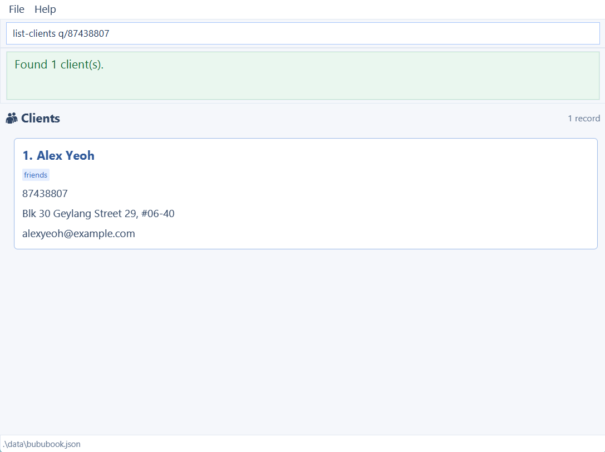

BuBu is a **desktop application for managing client contacts, pet profiles, and grooming appointments**, optimized for use through a Command Line Interface (CLI) while retaining the benefits of a Graphical User Interface (GUI).

* Table of Contents
{:toc}

--------------------------------------------------------------------------------------------------------------------

## Quick start

1. Ensure that Java `25` or later is installed on your computer.<br>
   **Mac users:** Ensure you have the precise JDK version prescribed [here](https://se-education.org/guides/tutorials/javaInstallationMac.html).

2. Download the latest `.jar` file from [here](https://github.com/AY2627S1-CS2103T-W08-2/tp/releases).

3. Copy the file to the folder you want to use as the _home folder_ for your BuBu.

4. Open a terminal, `cd` to the folder containing the JAR file, and run `java -jar bubu.jar`.<br>
   A GUI similar to the one below should appear in a few seconds. Note how the app contains some sample data.<br>
   

5. Type a command in the command box and press Enter to execute it. For example, type **`help`** and press Enter to display the command reference.<br>
   Use the <kbd>↑</kbd> and <kbd>↓</kbd> arrow keys in the command box to recall commands entered during the current
   application session.
   Some example commands you can try:

   * `list-clients` : Lists all clients.

   * `add-client n/John Doe i/98765432 e/johnd@example.com a/John street, block 123, #01-01` : Adds a client named `John Doe` to the BuBu.

   * `delete-client 3` : Deletes the 3rd client shown in the current list.

   * `delete-client i/91234567` : Deletes the client with phone number `91234567`.

   * `clear` : Deletes all clients, pets, and appointments.

   * `exit` : Exits the app.

6. Refer to the [Features](#features) section below for details of each command.

--------------------------------------------------------------------------------------------------------------------

## Features

<div markdown="block" class="alert alert-info">

**:information_source: Notes about the command format:**<br>

* Words in `UPPER_CASE` are the parameters to be supplied by the user.<br>
  For example, in `add-client n/NAME`, replace `NAME` with a value such as `John Doe`.

* Items in square brackets are optional.<br>
  For example, `n/NAME [t/TAG]` can be used as `n/John Doe t/friend` or as `n/John Doe`.

* Items followed by `…`​ can appear zero or more times.<br>
  For example, `[t/TAG]…​` may be omitted, or written as `t/friend` or `t/friend t/family`.

* Parameters can be in any order.<br>
  For example, if the command specifies `n/NAME i/PHONE_NUMBER`, `i/PHONE_NUMBER n/NAME` is also acceptable.

* Extra arguments after `help`, `exit`, and `clear` are ignored.<br>
  For example, `help 123` is interpreted as `help`. However, `list-appointments` accepts only an optional `d/` date filter.

* If you are using a PDF version of this document, be careful when copying and pasting commands that span multiple lines as space characters surrounding line-breaks may be omitted when copied over to the application.
</div>

### Recalling previously entered commands

Use the <kbd>↑</kbd> and <kbd>↓</kbd> arrow keys while the command box is focused to recall commands that you have
entered during the current application session. This is useful for repeating a command or editing a similar command
without typing it again.

* <kbd>↑</kbd> starts with the most recently entered command and moves towards older commands.
* <kbd>↓</kbd> moves towards newer commands. After the newest command, it restores a blank command box.
* At either end of the history, further presses of the corresponding arrow key leave the displayed text unchanged.
* Every non-empty submitted command is remembered, including commands that produced an error. If you begin typing a
  command and press <kbd>↑</kbd>, that unfinished command is remembered too; press <kbd>↓</kbd> to restore it.
  Recalling an unchanged command does not duplicate it in the history.
* Command history is kept only while BuBu is running and is cleared when the application closes.


### Switching the displayed record list

The GUI contains separate client, pet, and appointment list panels, but shows one panel at a time. A successful
`list-clients` command displays clients, `list-pets` displays pets, and `list-appointments` displays
ongoing and future appointments. The selected panel remains visible until another list command or a successful `edit-client` command changes it.

Index-based deletion commands use the corresponding displayed list. For example, run `list-pets` before
`delete-pet 1` and run `list-appointments` before `delete-appointment 1`. If the wrong record type is currently
displayed, the deletion is rejected rather than applying the index to another list.


### Shared error behavior

If the data file is invalid at startup, commands other than `help` are blocked with
`Unable to verify existing records. Please contact support.` Correct the file and restart BuBu before continuing.
An unrecognised command word reports an unknown-command error. Use the exact lowercase command words below.
When a save fails, previous records are restored in memory, but list filters or the visible selection may have changed.

Read-only commands (`help`, `list-clients`, `list-pets`, `list-appointments`, and `exit`) do not create or rewrite the records data file. Commands that change records save automatically; commands that leave the records unchanged skip saving. During shutdown, BuBu attempts to save window preferences separately in `preferences.json`.

Examples using existing clients or pets assume those records have already been added. Replace their identifiers with
values from your own records. Appointment examples also require a future date and an available slot.

### Viewing help: `help`

Displays the command reference in the feedback box. It does not change records or depend on the currently displayed list.

#### Format

```text
help
```

#### Parameters and validation

* This command takes no parameters. Extra text after `help` is ignored.

#### Examples

* `help` — displays available commands and their formats.

#### Success and other behavior

* On success, BuBu displays a scrollable command reference, with emphasised command names and monospace formats.
* The feedback box expands for help and returns to its usual size after the next command. The selected record panel stays unchanged.
* You can also open the reference using the **Help** menu or <kbd>F1</kbd>.

#### Error handling

The command makes no changes when it cannot be completed.

* `help` does not save records and does not require write access to the data file.
* `help` remains available even when an invalid data file prevents record commands from running.

### Adding a client: `add-client`

Adds a client contact and grooming address to the saved client records. The command works from any panel and checks all saved clients for duplicates.

#### Format

```text
add-client n/NAME i/PHONE_NUMBER e/EMAIL a/ADDRESS [t/TAG]...
```

#### Parameters and validation

* `n/NAME` — required and nonblank; Unicode letters and combining marks, spaces, apostrophes (`'`), hyphens (`-`) or full stops (`.`). Names such as `José Tan` and `李小明` are supported for both add and edit. Names are stored in Unicode NFC normalization (so composed and decomposed accents are treated alike), and must contain 2–60 Unicode code points after normalization. Spaces, punctuation and any remaining combining marks each count towards this limit; a visible letter can contain more than one code point.
* `i/PHONE_NUMBER` — required; exactly eight digits starting with `8` or `9`, without spaces or hyphens.
* `e/EMAIL` — required; at most 254 characters, exactly one `@`, no whitespace, and non-empty local and domain parts. The domain must have a full stop separating non-empty sections.
* `a/ADDRESS` — required and nonblank; 5–120 characters using English letters (`A-Z`, `a-z`), digits (`0-9`), spaces, commas, full stops, straight apostrophes (`'`), hyphens (`-`) or `#`. For example, `12 St. John's Road` is accepted for both add and edit.
* `t/TAG` — optional; a non-empty alphanumeric label without spaces. Repeat `t/` for multiple tags; omit it for no tags. Duplicate tags are stored once.
* Each required prefix may appear only once. Surrounding whitespace is trimmed; blank required values are rejected.
* Phone numbers and emails must be unique across clients. Email domains are compared case-insensitively, while the local part (before `@`) remains case-sensitive: `alice@example.com` conflicts with `alice@EXAMPLE.COM`, but `Alice@example.com` is distinct. The entered spelling is preserved for display and storage. Names and addresses need not be unique.
* The same uniqueness rule applies when loading saved data. If an older file contains emails differing only in domain capitalization, loading fails and commands are blocked to protect the original file; no clients are automatically merged or deleted. Back up the file, correct the conflicting contact details in the saved JSON, then restart BuBu.
* A phone number already present in an unrelated historical appointment owner snapshot cannot be reused for a new client or a changed client phone number. This prevents client edits or deletions from changing another person's historical appointment.

Required-field errors identify the field and distinguish an absent prefix from a blank value. For example, a missing `i/` reports `Phone number (i/) is required. Example: i/91234567.`, while a blank `e/` reports `Email (e/) cannot be blank.` A repeated `n/` reports `Name (n/) was supplied more than once. Keep only one n/ field.` The same wording applies to name, phone, email and address. Repeated `t/` fields remain valid. If multiple fields have errors, correct the reported field and retry.

#### Examples

* `add-client n/John Doe i/98765432 e/johnd@example.com a/123 Clementi Road` — adds an untagged client.
* `add-client n/Betsy Crowe i/91234567 e/betsy@example.com a/42 Orchard Road t/regular t/catOwner` — adds a client with two tags.

#### Success and other behavior

* On success, BuBu displays `Client added: NAME (PHONE).`
* The active client filter is preserved. The new client appears only if it matches the filter. The command does not switch away from a pet or appointment panel; use `list-clients` to view all clients.
* Changes are saved automatically. A save failure restores the previous records in memory and reports that the new client was not saved.

#### Error handling

The command makes no changes when it cannot be completed.

* Missing required field — a required prefix is absent or its value is blank.
* Repeated field — `n/`, `i/`, `e/` or `a/` appears more than once.
* Field validation error — a name, phone number, email, address or tag violates the rules above.
* `The phone number already belongs to another client.` - choose a different phone number.
* `The phone number is already used by a different historical appointment owner.` - choose a phone number not present in an unrelated historical appointment.
* `The email already belongs to another client.` - choose a different email address.
* `The phone number and email already belong to saved clients.` - change both fields; they may conflict with the same client or two different clients. Clients hidden by filters are checked too.
* Invalid command format — text appears before the recognised fields.
* Save failure — the new client was not saved and previous records were restored in memory. If write access was denied, check write permissions for the data file and folder, then retry. For other storage errors, check that the data folder is available and has free space, then retry. This does not guarantee that the data file on disk was restored.

### Listing and searching clients: `list-clients`

Shows all saved clients or searches their contact details. The search examines all clients, not just the currently filtered list.

#### Format

```text
list-clients [q/KEYWORD]
```

#### Parameters and validation

* `q/KEYWORD` - optional; omit it to show all clients. When supplied, use 1-60 characters after trimming. Any text or punctuation is accepted, including `+`, commas, underscores and slashes; blank queries and control characters (such as internal tabs or line breaks) are rejected.
* The keyword is one case-insensitive substring, including internal spaces, matched against name, phone, email or address; tags are not searched.
* Specify `q/` at most once.

#### Examples

* `list-clients` — lists all clients.
* `list-clients q/amelia` — finds clients with `amelia` in a contact field.
* `list-clients q/@example.com` — finds clients with that email-domain substring.
* `list-clients q/sam+grooming` - finds that literal email substring.
* `list-clients q/Road, #01-02` - finds that literal address substring.

#### Success and other behavior

* On success, BuBu displays `Listed all clients.`, `Found N client(s).` or `No clients match "KEYWORD".`
* The client panel is selected and results are sorted alphabetically by name, ignoring case.
* No matches is a successful search with an empty list. Saved records and their stored order are unchanged.

#### Error handling

The command makes no changes when it cannot be completed.

* `Search keyword must be 1-60 characters, not blank, and contain no control characters.` — the query is blank or invalid.
* `Each search field may be specified only once.` — `q/` is repeated.
* Invalid command format — arguments are provided outside the supported query field.

### Editing a client: `edit-client`

Edits a client by their index in the currently displayed client list or by their current phone number. The phone identifier searches all saved clients and works even when a filter hides the client or another panel is selected.

#### Format

```text
edit-client INDEX [n/NAME] [p/NEW_PHONE] [e/EMAIL] [a/ADDRESS] [t/TAG]...
edit-client i/CURRENT_PHONE [n/NAME] [p/NEW_PHONE] [e/EMAIL] [a/ADDRESS] [t/TAG]...
```

#### Parameters and validation

* Supply either `INDEX` or `i/CURRENT_PHONE`, not both. `INDEX` is a positive, one-based position in the displayed client list. Index-based editing requires the client panel; invalid or out-of-range indexes are rejected without changing records. The active filter remains applied after editing.
* `i/CURRENT_PHONE` — the client's existing eight-digit phone number starting with `8` or `9`.
* `n/NAME`, `p/NEW_PHONE`, `e/EMAIL`, `a/ADDRESS` — optional updates using the same value constraints as `add-client`. Omitted fields keep their values.
* `t/TAG` — optional alphanumeric tags replacing all existing tags. Repeat it to supply multiple tags; use `t/` alone to clear tags. Omit it to keep tags.
* Supply at least one update. Each of `i/`, `n/`, `p/`, `e/` and `a/` may appear only once.
* A changed phone or email must not belong to another saved client, including clients hidden by a search. Email domains are compared case-insensitively; the local part (before `@`) remains case-sensitive, as for `add-client`.
* A changed phone must also not reuse the phone number in an unrelated historical appointment owner snapshot.
* The old `edit` command is unsupported.

Missing selectors are reported separately from blank `i/` selectors. Supply either a displayed index or `i/CURRENT_PHONE`; combining both is rejected. Unexpected positional text is reported separately from invalid numeric indexes. Invalid `i/` values are identified as current-phone errors, while invalid `p/` values are identified as new-phone errors. Both phone values must be eight digits beginning with 8 or 9. Supply at least one update using `n/`, `p/`, `e/`, `a/` or `t/`.

#### Examples

* `edit-client 1 n/Alex Tan` - changes the first displayed client's name.
* `edit-client i/91234567 n/Alex Tan` — changes the selected client's name.
* `edit-client i/91234567 p/89998888` — changes their phone number; use the new number in subsequent commands.
* `edit-client i/89998888 t/` — clears that client's tags.

#### Success and other behavior

* On success, BuBu displays `Edited client: ...` and selects the client panel while preserving its active filter. Updated clients appear only if they still match the filter; a client that stops matching remains saved but disappears from the view.
* Linked pet owner profiles and owner details in ongoing and future appointments are updated, so `list-appointments` shows the current name and address. Completed appointments retain their recorded details, except that phone-number changes still update linked owner identifiers. Appointment dates, times, services and other pet details remain unchanged. An appointment is completed when its end date and time are at or before the time of the edit, using Singapore time.
* Changes are saved automatically. If saving fails, BuBu restores the previous records and displays a storage error.

#### Error handling

The command makes no changes when it cannot be completed.

* Invalid command format — the current-phone selector is missing or blank, or unsupported positional input is supplied.
* `No update supplied. Provide at least one of n/, p/, e/, a/ or t/.` — no update was supplied.
* Duplicate prefix or field validation error — a single-valued prefix is repeated or a supplied value is invalid.
* `No saved client has this phone number.` — the current phone does not identify a saved client.
* `The phone number already belongs to another client.` - choose a different phone number.
* `The phone number is already used by a different historical appointment owner.` - choose a phone number not present in an unrelated historical appointment.
* `The email already belongs to another client.` - choose a different email address.
* `The phone number and email already belong to saved clients.` - change both fields; they may conflict with the same client or two different clients. Clients hidden by filters are checked too.
* Save failure — the client update was not saved and previous records were restored in memory, including related pet and appointment records. If write access was denied, check write permissions for the data file and folder, then retry. For other storage errors, check that the data folder is available and has free space, then retry. This does not guarantee that the data file on disk was restored.

### Deleting a client: `delete-client`

Deletes a saved client and all pets and appointments linked to that client. Index-based deletion uses the displayed
client list; phone-based deletion searches all saved clients.

#### Format

```text
delete-client INDEX
delete-client i/PHONE_NUMBER
```

#### Parameters and validation

* `INDEX` — a positive integer referring to the client's one-based position in the currently displayed client list,
  including any search filter. The client panel must be displayed.
* `i/PHONE_NUMBER` — alternatively, a valid saved eight-digit phone number starting with `8` or `9`. This form can
  delete a client even when a filter or another panel hides them.
* Provide either an index or a phone identifier, not both. Specify `i/` only once.

#### Examples

* `delete-client 2` — deletes the second displayed client after `list-clients`.
* `delete-client i/91234567` — deletes the client with that number, even if a filter hides them.

#### Success and other behavior

* On success, BuBu displays `Deleted client: CLIENT_DETAILS. Removed PET_COUNT and APPOINTMENT_COUNT.`
  The counts use singular or plural wording, such as `1 pet` or `2 appointments`.
* All pets and appointments belonging to that client are also deleted, including completed appointments. Other clients' records are preserved.
* The selected panel does not change. There is no confirmation prompt.
* Changes are saved automatically. If saving fails, BuBu restores the previous records and displays a storage error.

#### Error handling

The command makes no changes when it cannot be completed.

* `Choose a client index or provide i/PHONE_NUMBER.` — no deletion target was supplied.
* `Choose either a client index or a phone identifier, not both.` — both target formats were supplied.
* `Unknown parameter: PARAMETER` — an unsupported prefix was supplied; the command format is shown.
* `Multiple values specified for the following single-valued field(s): i/` — the phone identifier was repeated.
* `Client index must be a positive whole number.` — the index is malformed or not positive.
* `The phone must be an 8-digit Singapore mobile number beginning with 8 or 9.` — the phone identifier is invalid.
* `The person index provided is invalid.` — the index is outside the current displayed client list.
* `No client with the given phone number exists.` — no saved client has the supplied phone number.
* Wrong displayed list — index-based deletion requires the matching record panel; run the corresponding list command first.
* Storage error — the data file cannot be written, for example because of file or folder permissions.

### Adding a pet: `add-pet`

Adds a pet under a registered client identified by phone number. It searches all clients and does not depend on the displayed client list.

#### Format

```text
add-pet p/PET_NAME i/OWNER_IDENTIFIER s/SPECIES [b/BREED] r/REQUIREMENTS
```

#### Parameters and validation

* `p/PET_NAME` — required; 1–40 letters, digits, spaces, apostrophes, hyphens or full stops.
* `i/OWNER_IDENTIFIER` — required; an existing client's eight-digit phone number starting with `8` or `9`.
* `s/SPECIES` — required; `Dog`, `Cat`, `Rabbit`, `Guinea Pig` or `Other`, ignoring case. `Guinea_Pig` is also accepted.
* `b/BREED` — optional; 2–50 characters after trimming, using only letters, digits, spaces, straight apostrophes (`'`), hyphens (`-`) or full stops (`.`). Omit it when unknown; an empty or whitespace-only supplied value is invalid.
  For mixed breeds, use a description such as `b/Poodle-Labrador mix`; `/` and `&` are not accepted.
  BuBu checks the text format only; it does not verify that the breed exists or matches the selected species.
* `r/REQUIREMENTS` — required; 5–240 characters and may contain `/`, e.g. `shampoo/conditioner`. A space followed by a recognised prefix starts another field.
* Each prefix may appear only once. Under one owner, pet names must be unique after ignoring case and extra whitespace. Different owners may have pets with the same name.
* Separate fields with ordinary spaces. Tabs inside the command are part of field values, not field separators.

#### Examples

* `add-pet p/Mochi i/87438807 s/Dog b/Golden retriever r/Nervous around dryers` — adds Mochi with a breed under the client with that phone.
* `add-pet p/BuBu i/87438807 s/Cat r/Calm with baths` — adds a pet without a recorded breed. The owner must already exist.

#### Success and other behavior

* On success, BuBu displays `Pet added: PET_NAME (SPECIES, BREED) under OWNER.` The breed is omitted from the message when not supplied.
* The active pet filter is preserved. A new pet appears only if it matches the filter. The client filter and selected panel are unchanged; use `list-pets` to view all pets.
* Changes are saved automatically. A save failure restores the previous records in memory and displays one of the save-error messages below.

#### Error handling

The command makes no changes when it cannot be completed.

* `Each pet field may be specified only once.` — a prefix is repeated.
* Field validation error — a name, owner phone, species, breed or requirement is invalid.
* After the command structure is accepted, supplied non-empty fields are validated before missing fields are reported.
* `Missing required field: FIELD.` followed by the command format and example — a mandatory field is omitted or blank.
  The owner is looked up only after all required fields are supplied and their formats are valid.
* `Invalid command format!` followed by the `add-pet` usage and example — unsupported prefixes or text outside a field are supplied.
* `No saved client has this phone number. Add the client before adding a pet.` — the phone format is valid, but no registered client has that number.
* `This client already has a pet named PET_NAME.` — the name conflicts with another pet under that owner.
* `Records changed outside this BuBu window. Close and reopen BuBu, then retry your command.` — the data file changed or was deleted since it was loaded. Reopen BuBu to load the current records before retrying.
* `Another BuBu window is saving records. Retry your command.` — another save holds the data-file lock. Wait for it to finish, then retry. If the records have changed, BuBu will ask you to reopen the app.
* `Unable to save a pet. Please try again.` — another storage error prevented saving the updated records.

### Listing pet profiles: `list-pets`

Shows all saved pets or only those belonging to one registered client. It selects the pet panel without changing saved records or the client filter.

#### Format

```text
list-pets [i/OWNER_IDENTIFIER]
```

#### Parameters and validation

* `i/OWNER_IDENTIFIER` — optional; an existing client's eight-digit phone number starting with `8` or `9`. Omit it to list every owner's pets.
* Specify `i/` at most once. Keyword or pet-name search is not supported.

#### Examples

* `list-pets` — shows all saved pet profiles.
* `list-pets i/87438807` — shows only pets belonging to the client with that phone number.

#### Success and other behavior

* On success, BuBu displays `Listed all pets.`, `Found N pet(s) under OWNER.` or `OWNER has no saved pet profiles.`
* Pets are ordered by owner name, owner phone, then pet name. Names are compared ignoring case; owners with the same name remain separate groups.
* Each owner group has a heading. Record numbers continue across groups. Pet cards show name, species, breed and care requirements; an absent breed appears as `Not recorded`.
* An empty result is successful. This command does not save or change records.

#### Error handling

The command makes no changes when it cannot be completed.

* `No saved client has this phone number.` — the supplied phone has no registered client.
* `The owner phone may be specified only once.` — `i/` is repeated.
* `The phone must be an 8-digit Singapore mobile number beginning with 8 or 9.` — the phone format is invalid.
* `Invalid command format!` followed by the `list-pets` usage and example — unsupported fields or extra text are supplied.

### Editing a pet: `edit-pet`

Edits a saved pet identified by its current name and owner's phone number, or by its one-based index in the displayed pet list. Name-and-phone lookup searches all saved pets, regardless of the displayed list; index lookup requires the pet list to be displayed. The command never transfers ownership.

#### Format

```text
edit-pet INDEX [n/NEW_PET_NAME] [s/SPECIES] [b/BREED] [r/REQUIREMENTS]
edit-pet p/PET_NAME i/OWNER_IDENTIFIER [n/NEW_PET_NAME] [s/SPECIES] [b/BREED] [r/REQUIREMENTS]
```

#### Parameters and validation

* `INDEX` — alternatively, a positive integer referring to the pet's one-based position in the currently displayed pet list, including any owner filter. The pet list must be the active display.
* `p/PET_NAME` — required for name-and-phone targeting; the current name must contain 1–40 letters, digits, spaces, apostrophes, hyphens or full stops. Lookup ignores case and extra whitespace.
* `i/OWNER_IDENTIFIER` — required with `p/`; the current owner's eight-digit phone number starting with `8` or `9`.
* `n/NEW_PET_NAME` — optional replacement name with the same constraints. It must not match another pet under the owner after case and whitespace normalisation.
* `s/SPECIES` — optional; `Dog`, `Cat`, `Rabbit`, `Guinea Pig` or `Other`, ignoring case. `Guinea_Pig` is also accepted.
* `b/BREED` — optional; a nonblank replacement must contain 2–50 characters after trimming, using only letters, digits, spaces, straight apostrophes (`'`), hyphens (`-`) or full stops (`.`). Use `b/` alone (or a whitespace-only value) to remove the breed; omit the field to keep it unchanged.
  For mixed breeds, use a description such as `b/Poodle-Labrador mix`; `/` and `&` are not accepted.
  BuBu checks the text format only; it does not verify that the breed exists or matches the selected species.
* `r/REQUIREMENTS` — optional; 5–240 characters and may contain `/`, e.g. `shampoo/conditioner`. A space followed by a recognised prefix starts another field.
* Supply either `INDEX` or both `p/PET_NAME` and `i/OWNER_IDENTIFIER`, not both targeting forms. Supply at least one update. Omitted fields are unchanged. Every prefix may appear only once.

#### Examples

* `edit-pet p/Mochi i/87438807 n/Mochi Bean r/Prefers quiet drying` — changes the pet's name and requirements.
* `edit-pet p/Mochi Bean i/87438807 b/` — removes the saved breed after that rename.
* `edit-pet 1 n/Mochi Bean` — changes the name of the first pet in the displayed pet list.

#### Success and other behavior

* On success, BuBu displays `Edited pet: PET_NAME`.
* The active pet filter is preserved and matching pets show their updated details. Pets outside the filter remain hidden; the selected panel does not change.
* Linked ongoing and future appointments receive the updated pet name, species, breed and care requirements. Completed appointments keep their recorded pet details, except that a changed pet name still updates linked bookings. An appointment is completed when its end date and time are at or before the time of the edit, using Singapore time. Appointment dates, times, services and recorded owner details remain unchanged.
* Changes are saved automatically. If saving fails, BuBu restores the previous records and displays a storage error.

#### Error handling

The command makes no changes when it cannot be completed.

* `Missing required field: PET_NAME.` or `Missing required field: OWNER_IDENTIFIER.` — the name-and-phone targeting form is incomplete.
* `At least one field to edit must be provided.` — no update was supplied.
* `Each pet field may be specified only once.` — a prefix is repeated.
* Field validation error — a supplied name, phone, species, breed or requirement is invalid.
* `Invalid command format. Check the command syntax and try again.` — unsupported prefixes or text outside a field are supplied.
* `A pet index cannot be combined with pet-name or owner-phone identifiers.` — both targeting forms were supplied.
* `The current displayed list does not match the record type selected by the index.` — the pet list is not currently displayed.
* `The pet index provided is invalid.` — the index is outside the displayed pet list.
* `No pet with the specified name and owner phone number was found.` — the name-and-phone selectors do not identify a saved pet.
* `This client already has a pet named PET_NAME.` — the new name conflicts with another pet under the owner.
* Storage error — the data file cannot be written, for example because of file or folder permissions.

### Deleting a pet: `delete-pet`

Deletes a saved pet and its linked appointments. Index-based deletion uses the displayed pet list; name-and-phone deletion searches all saved pets.

#### Format

```text
delete-pet INDEX
delete-pet p/PET_NAME i/OWNER_IDENTIFIER
```

#### Parameters and validation

* `INDEX` — a positive integer referring to the pet's one-based position in the current pet list, including any owner filter.
* `p/PET_NAME` — alternatively, the saved pet name; 1–40 letters, digits, spaces, apostrophes, hyphens or full stops. The name is matched case-insensitively; leading and trailing whitespace is ignored, and repeated internal whitespace is treated as a single space, consistent with edit lookup.
* `i/OWNER_IDENTIFIER` — required with `p/`; the owner's eight-digit phone number starting with `8` or `9`.
* Provide an index or both identifiers, not both formats. Each identifier prefix may appear only once.

#### Examples

* `delete-pet 1` — deletes the first pet after displaying the desired list with `list-pets`.
* `delete-pet p/MILO i/98765432` — deletes the saved pet named `Milo` under that owner. Case and whitespace differences do not prevent a match.

#### Success and other behavior

* On success, BuBu displays `Deleted pet: PET_NAME`.
* Appointments linked to that pet are also deleted. The client and other pets are preserved.
* The selected panel does not change. There is no confirmation prompt.
* Changes are saved automatically. If saving fails, BuBu restores the previous records and displays a storage error.

#### Error handling

The command makes no changes when it cannot be completed.

* Invalid command format or field validation error — a target is missing, incomplete or invalid, or an identifier prefix is repeated.
* `A pet index cannot be combined with a pet name or owner identifier.` — the two target formats are mixed.
* `The pet index provided is invalid.` — the index is outside the current pet list.
* `No pet with the specified name and owner phone number was found.` — no exact name-and-phone match exists.
* Wrong displayed list — index-based deletion requires the matching record panel; run the corresponding list command first.
* Storage error — the data file cannot be written, for example because of file or folder permissions.

### Scheduling an appointment: `add-appointment`

Schedules a grooming appointment for a registered pet and client. It searches saved records rather than the currently displayed list and checks the slot against all appointments.

#### Format

```text
add-appointment i/OWNER_PHONE p/PET_NAME d/DD-MM-YYYY st/HH:mm et/HH:mm s/SERVICE
```

#### Parameters and validation

* `i/OWNER_PHONE` — required; a registered client's eight-digit phone number starting with `8` or `9`.
* `p/PET_NAME` — required; a pet registered under that client. Use 1–40 letters, digits, spaces, apostrophes, hyphens or full stops; lookup ignores case and repeated whitespace.
* `d/DD-MM-YYYY` — required; a real calendar date. The combined date and start time must be strictly in the future in Singapore time.
* `st/HH:mm` — required; a 24-hour start time from `08:00` to `19:30`, in 30-minute intervals.
* `et/HH:mm` — required; an end time from `08:30` to `20:00`, in 30-minute intervals and at least 30 minutes after the start on the same day.
* `s/SERVICE` — required; `Bath and brush`, `Full groom`, `Nail trim` or `Other`. Case and extra whitespace are ignored.
* Each prefix may appear only once. Slots must not overlap any other appointment, including bookings for different pets; adjacent slots are allowed.

#### Examples

* `add-appointment i/87438807 p/BuBu d/18-09-2027 st/10:00 et/11:00 s/Full groom` — books a full groom for the registered pet.
* `add-appointment i/87438807 p/BuBu d/18-09-2027 st/11:00 et/11:30 s/Nail trim` — books an adjacent slot. Choose a future date and ensure the slots are free.

#### Success and other behavior

* On success, BuBu displays `Appointment scheduled: ...` with the pet, owner phone, date, time and service.
* The booking records the participant details available at booking time. The selected panel does not change; use `list-appointments` to view the updated schedule.
* Changes are saved automatically. If saving fails, BuBu restores the previous records and displays a storage error.

#### Error handling

The command makes no changes when it cannot be completed.

* Invalid command format, duplicate prefix or field validation error — a field is missing, repeated or invalid, or positional text is supplied.
* `This phone number does not identify a unique registered owner.` — the owner cannot be resolved.
* `This pet is not registered under the specified owner.` — the pet does not belong to that client.
* `Appointment must start in the future (Singapore time).` — the requested start has passed or is the current time.
* `This appointment overlaps an existing booking for PET_NAME on DD-MM-YYYY, HH:mm–HH:mm.` — the slot conflicts with the identified saved booking, even if that booking is hidden by the current list filter. If several bookings overlap, one conflicting booking is shown.
* Storage error — the data file cannot be written, for example because of file or folder permissions.

### Listing appointments: `list-appointments`

Shows ongoing and future appointments in the appointment panel, or all appointments on a specified date, ordered by date and start time. It reads all saved bookings rather than depending on the currently displayed list.

#### Format

```text
list-appointments [d/DD-MM-YYYY]
```

#### Parameters and validation

* Without a date filter, only ongoing and future appointments are shown, using Singapore time. Appointments that have already ended, including earlier today or exactly now, are excluded.
* `d/` — optional date in `DD-MM-YYYY` format. Shows every appointment on that date, including completed appointments. Past dates are allowed.
* Only one date may be supplied. Invalid dates, extra arguments, phone filters, and pet-name filters are rejected.

#### Examples

* `list-appointments` — displays the current ongoing and future schedule.
* `list-appointments d/28-10-2026` — displays all appointments on 28 October 2026, including any that have already ended.

#### Success and other behavior

* On success, BuBu displays `Ongoing or future appointments found: N.` or `No ongoing or future appointments.`
* With a date filter, BuBu displays `Appointments on DD-MM-YYYY found: N.` or `No appointments on DD-MM-YYYY.`
* Without a date filter, an appointment is included if its end time is after the time when the command runs, using Singapore time. Run the command again to refresh this time-based selection.
* Appointments have date headings and continuous record numbers. Cards show service and timing, pet and owner details, address and care notes saved with the booking.
* Completed appointments remain saved and can be viewed with the date filter. No matches is a successful result; this command does not save or change records.

#### Error handling

The command makes no changes when it cannot be completed.

* Invalid command format — unsupported arguments or extra text are supplied.
* Invalid date — the date is missing, impossible, or not in `DD-MM-YYYY` format.
* Duplicate date prefix — more than one `d/` parameter is supplied.
* `Unable to verify existing records. Please contact support.` — commands are blocked because the data file was invalid at startup.

### Editing an appointment: `edit-appointment`

Edits a saved appointment identified by its current date and start time, or by its displayed appointment-list index.

#### Format

```text
edit-appointment d/CURRENT_DATE st/CURRENT_START_TIME [i/NEW_OWNER_PHONE] [p/NEW_PET_NAME] [nd/NEW_DATE] [nst/NEW_START_TIME] [et/NEW_END_TIME] [s/NEW_SERVICE]
edit-appointment INDEX [i/NEW_OWNER_PHONE] [p/NEW_PET_NAME] [nd/NEW_DATE] [nst/NEW_START_TIME] [et/NEW_END_TIME] [s/NEW_SERVICE]
```

#### Parameters and validation

* `d/` and `st/` identify the existing appointment. Identifier-based edits search all saved appointments.
* `INDEX` refers to the one-based position in the currently displayed appointment list. Run `list-appointments`
  first when using this form; a date-filtered appointment list may also be used.
* Provide either the date/start-time identifiers or an index, but not both. Replacement fields can be combined with
  either identification form.
* `CURRENT_DATE` and `NEW_DATE` use `DD-MM-YYYY`. `CURRENT_START_TIME`, `NEW_START_TIME`, and `NEW_END_TIME` use
  `HH:mm`.
* When supplied, `i/NEW_OWNER_PHONE` must identify a registered client, and `p/NEW_PET_NAME` must identify a pet
  registered under that client. Pet-name matching ignores letter case and repeated whitespace.
* Start times must be from `08:00` to `19:30` in 30-minute intervals. End times must be from `08:30` to `20:00`
  in 30-minute intervals and at least 30 minutes after the appointment start time.
* Use `nd/` and `nst/` when changing the appointment's date or start time. At least one replacement field is required.
* The resulting appointment must start in the future in Singapore time and must not overlap another appointment.
  An appointment whose resulting start time is in the past cannot be edited.

#### Examples

* `edit-appointment d/18-09-2027 st/10:00 s/Full groom` changes the service for the appointment starting at 10:00.
* `edit-appointment d/18-09-2027 st/10:00 nd/19-09-2027 nst/11:00 et/12:00` moves the appointment to a new date
  and time and changes its end time.
* `edit-appointment 1 et/12:00` changes the end time of the first appointment in the displayed appointment list.

#### Success and other behavior

* On success, BuBu displays `Edited appointment: ...` with the updated booking details.
* Fields that are not supplied keep their existing values. The selected panel and active appointment filter are
  preserved; an updated appointment that no longer matches the filter disappears from the view but remains saved.
* Changes are saved automatically. If saving fails, BuBu restores the previous records and displays a storage error.

#### Error handling

The command makes no changes when it cannot be completed.

* `Choose an appointment index, or provide both d/CURRENT_DATE (DD-MM-YYYY) and st/CURRENT_START_TIME (HH:mm).` —
  the target is missing or incomplete.
* `Missing parameter: d/CURRENT_DATE (DD-MM-YYYY)` or `Missing parameter: st/CURRENT_START_TIME (HH:mm)` — one of the
  required target prefixes is missing; the command format and parameters are shown.
* `Unknown parameter: PARAMETER` — an unsupported prefix was supplied; the command format and parameters are shown.
* Duplicate-prefix error — a single-valued prefix was supplied more than once.
* `Appointment index must be a positive whole number.` — the index is malformed or not positive.
* `Choose either an appointment index or a date and start time, not both.` — both target formats are supplied.
* `Specify at least one appointment detail to change using i/NEW_OWNER_PHONE, p/NEW_PET_NAME, nd/NEW_DATE,
  nst/NEW_START_TIME, et/NEW_END_TIME or s/NEW_SERVICE.` — no replacement field is supplied.
* Invalid appointment date — use `DD-MM-YYYY`, such as `18-09-2027`, and enter a real calendar date.
* Invalid start or end time — use `HH:mm`, such as `10:00`, and follow the allowed appointment time ranges.
* Invalid owner phone, pet name or service — follow the field constraints shown in the error message.
* `The appointment index provided is not in the displayed appointment list.` — the index is outside the current list.
* `The current displayed list does not match the record type selected by the index.` — run `list-appointments` before
  using an index.
* `No appointment starts at the specified date and start time.` — no matching appointment exists.
* `No registered owner matches the specified phone number.` — the replacement owner cannot be found.
* `This pet is not registered under the specified owner.` — the replacement pet cannot be found for that owner.
* `No changes were made. The appointment already has these details.` — all requested values match the existing
  appointment.
* `The new start time must be at least 30 minutes before the existing end time.` — only the replacement start time
  makes the duration too short.
* `The new end time must be at least 30 minutes after the existing start time.` — only the replacement end time makes
  the duration too short.
* `The appointment duration must be at least 30 minutes.` — both replacement times were supplied but form an invalid
  duration.
* `The updated appointment must start in the future (Singapore time).` — the new start has passed.
* `The updated appointment overlaps another appointment. Choose an available time slot.` — the new slot conflicts
  with an existing appointment.

### Deleting an appointment: `delete-appointment`

Deletes a booking by its displayed index or its date and start time. Date-and-start-time lookup searches all saved appointments, including completed bookings hidden from the list.

#### Format

```text
delete-appointment INDEX
delete-appointment d/DD-MM-YYYY st/HH:mm
```

#### Parameters and validation

* `INDEX` — a positive integer referring to the appointment's one-based position in the currently displayed appointment
  list. Run `list-appointments` first; a date-filtered appointment list may also be used.
* `d/DD-MM-YYYY` — alternatively, a real calendar date; it need not be in the future.
* `st/HH:mm` — required with `d/`; use the exact start time of the appointment to delete, not any time within its
  duration. It must be from `08:00` to `19:30` in 30-minute intervals.
* Provide an index or both date and time, not both formats. Each prefix may appear only once.

#### Examples

* `delete-appointment 1` — deletes the first displayed appointment.
* `delete-appointment d/18-09-2027 st/10:30` — deletes the booking starting at 10:30 on that date, if one exists.

#### Success and other behavior

* On success, BuBu displays `Deleted appointment: ...` with the booking details.
* Client and pet profiles and other appointments are preserved. The selected panel does not change.
* Changes are saved automatically. If saving fails, BuBu restores the previous records and displays a storage error.

#### Error handling

The command makes no changes when it cannot be completed.

* `Choose an appointment index, or provide both d/DATE (DD-MM-YYYY) and st/START_TIME (HH:mm).` — the target is missing or
  incomplete.
* `Missing parameter: d/DATE (DD-MM-YYYY)` or `Missing parameter: st/START_TIME (HH:mm)` — one of the required target
  prefixes is missing; the command format and parameters are shown.
* `Unknown parameter: PARAMETER` — an unsupported prefix was supplied; the command format and parameters are shown.
* Duplicate-prefix error — a single-valued prefix was supplied more than once.
* `Appointment index must be a positive whole number.` — the index is malformed or not positive.
* Invalid appointment date — use `DD-MM-YYYY`, such as `18-09-2027`, and enter a real calendar date.
* Invalid appointment start time — use `HH:mm`, such as `10:30`, from `08:00` to `19:30` in 30-minute intervals.
* `Choose either an appointment index or a date and time, not both.` — both target formats are supplied.
* `The appointment index provided is not in the displayed appointment list.` — the index is outside the current list.
* `The current displayed list does not match the record type selected by the index.` — run `list-appointments` before
  using an index.
* `No appointment starts at the specified date and start time.` — no booking starts at that date and start time.
* Storage error — the data file cannot be written, for example because of file or folder permissions.

### Clearing all entries: `clear`

Deletes all saved clients, pets and appointments, including completed bookings and records hidden by filters. It does not depend on the displayed list.

#### Format

```text
clear
```

#### Parameters and validation

* This command takes no parameters. Extra text is ignored.

#### Examples

* `clear` — permanently removes all records after a successful save. Back up the data file first if needed.

#### Success and other behavior

* On success, BuBu displays `Clients, pets, and appointments have been cleared!`
* The command takes effect immediately without confirmation. The selected panel remains selected but contains no records.
* Changes are saved automatically. If saving fails, BuBu restores the previous records and displays a storage error.

#### Error handling

The command makes no changes when it cannot be completed.

* Storage error — the data file cannot be written, for example because of file or folder permissions.
* `Unable to verify existing records. Please contact support.` — commands are blocked because the data file was invalid at startup.

### Exiting the program: `exit`

Closes BuBu without deleting saved records. It does not depend on the displayed list.

#### Format

```text
exit
```

#### Parameters and validation

* This command takes no parameters. Extra text is ignored.

#### Examples

* `exit` — closes the application.

#### Success and other behavior

* On success, BuBu displays `Exiting BuBu as requested ...` and closes.
* `exit` does not save record data. Record changes are saved when the commands that make them succeed. During shutdown, BuBu attempts to save window preferences separately in `preferences.json`. Session command history is not retained.

#### Error handling

The command makes no changes when it cannot be completed.

* `Unable to verify existing records. Please contact support.` — commands, including `exit`, are blocked by the startup data-file error; close the window instead.

### Saving the data

Clients, pets, and appointments are saved together in `data/bububook.json` automatically after successful changes.
If saving fails, BuBu restores the previous records and displays an error. Read-only commands (`help`, `exit`,
`list-clients`, `list-pets` and `list-appointments`) do not create or rewrite this file. Other commands also skip
saving when the records are unchanged. Window preferences are saved separately in `preferences.json` during shutdown.

If another BuBu window changes the same data file, your next change is rejected with
`Records changed outside this BuBu window. Close and reopen BuBu, then retry your command.`
The other window's saved records are preserved, and your attempted change is undone in memory.
Reopen the affected window to load the latest records before entering the command again.
If another window is still saving, BuBu instead asks you to retry your command.

BuBu keeps a small `data/bububook.json.lock` file beside the records to coordinate saves between windows.
Leave it in place while BuBu is open. It is normal for this file to remain after closing the app;
the operating system releases the lock when the save finishes or the process exits.

If upgrading from a version that used `data/groombook.json`, close BuBu and copy that file to
`data/bububook.json` before launching the new version. Keep the original file as a backup.
The app loads this file at startup; you do not need to save manually. Window preferences are stored separately.
Bookings use the same data file as their registered clients and pets. Client edits refresh owner details in linked
ongoing and future bookings; pet edits refresh their pet details. A booking is ongoing or future if its end date
and time are strictly after the time of the edit in Singapore time. Bookings ending before or exactly at that time
are completed and retain their historical details, except that linked owner-phone and pet-name changes still apply.
Profile edits do not change appointment dates, times or services. Pet edits keep the recorded owner details;
client edits keep the recorded pet details other than the pet's owner information.
Deleting a client or pet also deletes their linked bookings. The recorded pet name is displayed with its capitalization.

Older bookings that saved only an owner phone and pet name can be loaded while both participants remain
registered. If either is missing, restore the missing participant from a backup before upgrading; those older
bookings do not contain a full participant profile.

### Editing the data file

By default, grooming records are saved in `data/bububook.json` relative to the terminal's working directory when
BuBu is launched, with `clients`, `pets`, and `appointments` lists. Following the Quick start instructions makes
this the folder containing the JAR. Always launch from the same folder to load the same records; launching from
another folder can make BuBu use a different data file. Advanced users can edit the file while the app is closed.

<div markdown="span" class="alert alert-warning">:exclamation: **Caution:**
Back up the file before editing it. If the file becomes invalid, BuBu starts with an empty model and blocks
commands with `Unable to verify existing records. Please contact support.` to avoid overwriting your records.
Correct the file and restart the app before continuing.
</div>

### Archiving data files `[coming in v2.0]`

_Details coming soon ..._

--------------------------------------------------------------------------------------------------------------------

## FAQ

**Q**: How do I transfer my data to another computer?<br>
**A**: With the default data-file location, follow these steps:

1. Close BuBu on both computers and keep a backup of `data/bububook.json` from your original launch folder.
2. Put the JAR in your intended launch folder on the other computer. Create a `data` subfolder there if it does not exist.
3. Copy your backup into that subfolder as `bububook.json`. If a destination file already exists, back it up before replacing it.
4. Open a terminal in that same launch folder and run `java -jar bubu.jar`. BuBu will load the copied records.

A fresh launch without a data file loads sample records into memory; it does not create `data/bububook.json`.
You do not need to add a dummy record before copying your backup. Keep the destination app closed while copying:
an already-open window retains its in-memory records and may reject later changes because the data file changed externally.

--------------------------------------------------------------------------------------------------------------------

## Known issues

1. **When using multiple screens**, if you move the application to a secondary screen, and later switch to using only the primary screen, the GUI will open off-screen. The remedy is to delete the `preferences.json` file created by the application before running the application again.

--------------------------------------------------------------------------------------------------------------------

## Command summary

Action | Format, Examples
--------|------------------
**Add Client** | `add-client n/NAME i/PHONE_NUMBER e/EMAIL a/ADDRESS [t/TAG]…​` <br> e.g., `add-client n/James Ho i/82224444 e/jamesho@example.com a/123, Clementi Rd, 1234665 t/friend t/colleague`
**List clients** | `list-clients [q/KEYWORD]`<br> e.g., `list-clients q/amelia`
**Edit client** | `edit-client INDEX [n/NAME] [p/NEW_PHONE] [e/EMAIL] [a/ADDRESS] [t/TAG]...` or `edit-client i/CURRENT_PHONE [n/NAME] [p/NEW_PHONE] [e/EMAIL] [a/ADDRESS] [t/TAG]...`<br> e.g., `edit-client i/91234567 n/Alex Tan`
**Delete Client** | `delete-client INDEX` or `delete-client i/PHONE_NUMBER`<br> e.g., `delete-client 3`<br> e.g., `delete-client i/91234567`
**Add pet** | `add-pet p/PET_NAME i/OWNER_IDENTIFIER s/SPECIES [b/BREED] r/REQUIREMENTS`<br> e.g., `add-pet p/Mochi i/87438807 s/Dog r/Nervous around dryers`
**List pets** | `list-pets [i/OWNER_IDENTIFIER]`<br> e.g., `list-pets i/87438807`
**Edit pet** | `edit-pet INDEX [n/NEW_PET_NAME] [s/SPECIES] [b/BREED] [r/REQUIREMENTS]` or `edit-pet p/PET_NAME i/OWNER_IDENTIFIER [n/NEW_PET_NAME] [s/SPECIES] [b/BREED] [r/REQUIREMENTS]`<br> e.g., `edit-pet 1 n/Mochi Bean`<br> e.g., `edit-pet p/Mochi i/87438807 n/Mochi Bean`
**Delete pet** | `delete-pet INDEX` or `delete-pet p/PET_NAME i/OWNER_IDENTIFIER`<br> e.g., `delete-pet p/Milo i/98765432`
**Add appointment** | `add-appointment i/OWNER_PHONE p/PET_NAME d/DD-MM-YYYY st/HH:mm et/HH:mm s/SERVICE`
**List appointments** | `list-appointments [d/DD-MM-YYYY]`
**Edit appointment** | `edit-appointment d/CURRENT_DATE st/CURRENT_START_TIME [i/NEW_OWNER_PHONE] [p/NEW_PET_NAME] [nd/NEW_DATE] [nst/NEW_START_TIME] [et/NEW_END_TIME] [s/NEW_SERVICE]` or `edit-appointment INDEX [...]`<br> e.g., `edit-appointment d/18-09-2027 st/10:00 et/12:00`
**Delete appointment** | `delete-appointment INDEX` or `delete-appointment d/DD-MM-YYYY st/HH:mm` <br> e.g., `delete-appointment d/18-09-2027 st/10:30`
**Clear** | `clear`
**Help** | `help`
**Exit** | `exit`
